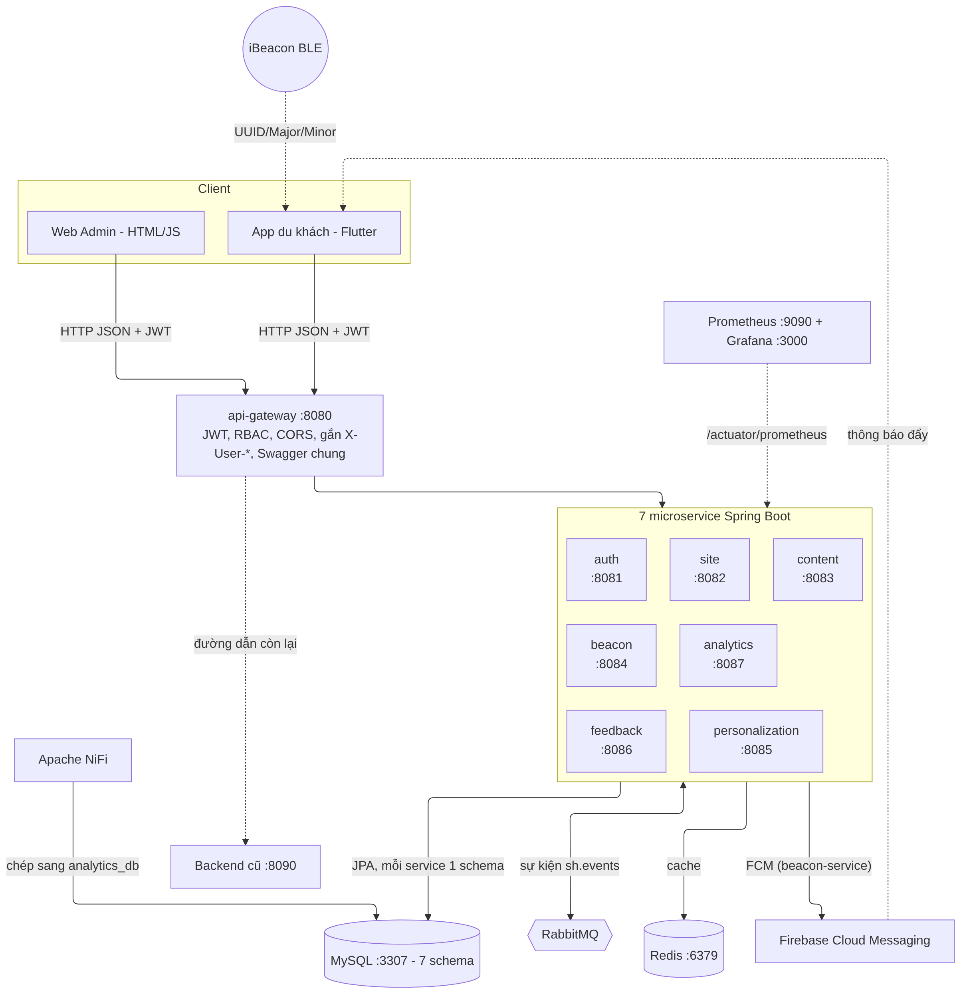
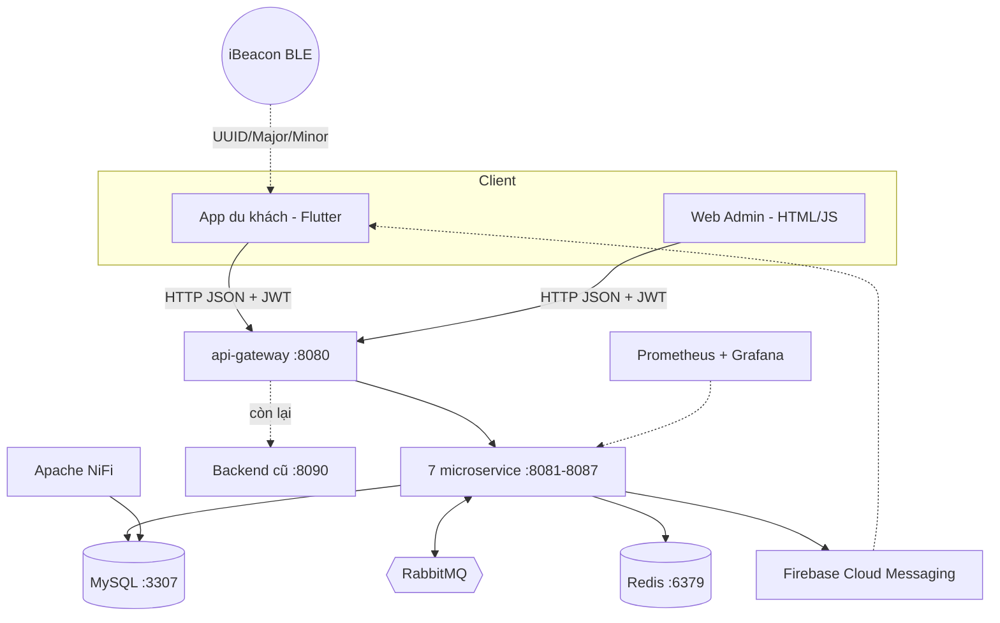
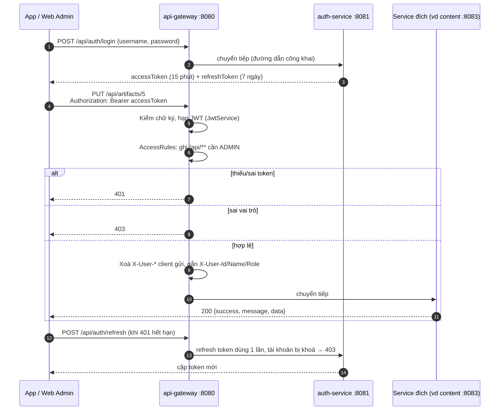
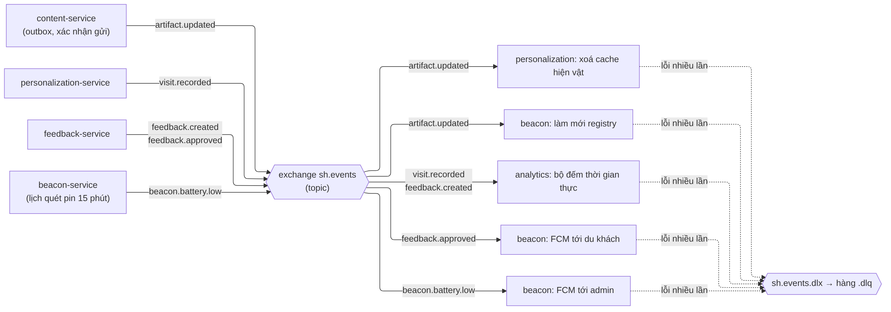
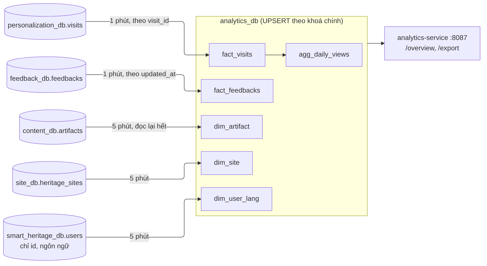
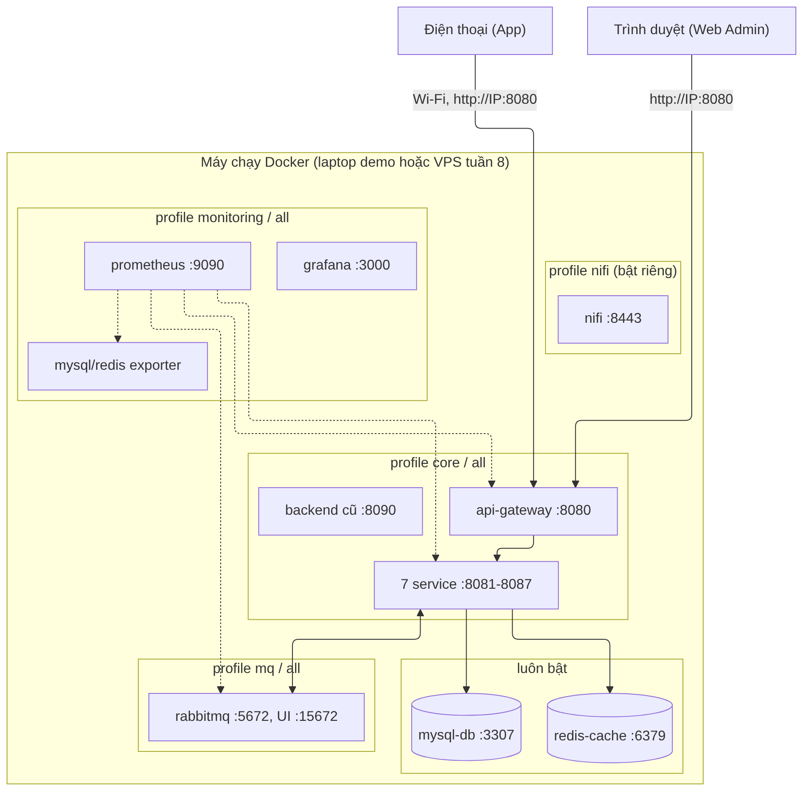

# Tài liệu thiết kế kiến trúc hệ thống – Smart Heritage

| Mục | Nội dung |
|---|---|
| Phiên bản | Bản cuối – Sprint 7 (XDPMHDT-96). Thay phần trạng thái tuần 4 trong [microservices.md](microservices.md) (giữ lại làm lịch sử) |
| Căn cứ | Code trên `main` `c365dac` và 4 patch tuần 7 (chờ merge): `GatewayRoutesConfig.java`, `AccessRules.java`, `Infra/docker-compose.yml`, `Infra/db`, `services/common/events` |
| Tài liệu liên quan | [SRS](../requirements/SRS.md), [Deployment Guide](../deployment/deployment-guide.md), [NiFi](../research/nifi-setup.md), [Giám sát](../../Infra/monitoring/README.md) |

## 1. Mục tiêu kiến trúc

| Yêu cầu (SRS) | Quyết định kiến trúc đáp ứng |
|---|---|
| NFR-05 ≥ 500 người dùng, mở rộng ngang | Tách 7 microservice không giữ trạng thái phiên (JWT), mỗi service chạy và nhân bản độc lập |
| NFR-04 bảo mật, RBAC | Một điểm vào duy nhất (API Gateway) kiểm JWT và phân quyền; service phía sau không nhận request trực tiếp từ client |
| NFR-07 tin cậy | Sự kiện RabbitMQ có xác nhận gửi, outbox, DLQ, chống xử lý trùng theo `eventId`; đồng bộ offline chống trùng theo `clientEventId` |
| NFR-08 bảo trì | Mỗi service một schema, một nhóm người phụ trách; module `common` dùng chung (JWT, `CurrentUser`, sự kiện); Swagger gom tại Gateway |
| NFR-10 giám sát | Mọi service xuất `/actuator/prometheus`; 8 quy tắc cảnh báo; dashboard Grafana |
| Dashboard ≤ 5 giây (NFR-02) | Tách đọc thống kê sang `analytics_db` do NiFi tổng hợp; số liệu hôm nay cập nhật bằng sự kiện |

## 2. Sơ đồ container

| Container | Công nghệ | Trách nhiệm | Dữ liệu sở hữu | Phụ trách |
|---|---|---|---|---|
| App du khách | Flutter (Android, iOS, Web) | Quét iBeacon, hiển thị nội dung, bản đồ, yêu thích, lịch sử, đánh giá, cache offline, FCM | Bộ nhớ cục bộ (SharedPreferences) | Cả nhóm |
| Web Admin | HTML, CSS, JS thuần; Chart.js; Leaflet | Menu chung, CMS, beacon, phản hồi, người dùng, Dashboard | – | Cả nhóm |
| api-gateway :8080 | Spring Cloud Gateway (WebFlux) | Định tuyến, JWT, RBAC, CORS, Swagger chung | – | Bảo |
| auth-service :8081 | Spring Boot, Spring Security (BCrypt), jjwt | Đăng ký, đăng nhập, token, hồ sơ, quản lý người dùng | users, refresh_tokens | Bảo |
| site-service :8082 | Spring Boot, JPA | Di tích, toạ độ, nearby (Haversine) | site_db | Ân |
| content-service :8083 | Spring Boot, JPA | Hiện vật, nội dung đa ngôn ngữ, media, ngôn ngữ; outbox sự kiện | content_db; thư mục media | Xuân Anh |
| beacon-service :8084 | Spring Boot, JPA, Firebase Admin | iBeacon, registry, vị trí, pin, token thiết bị, gửi FCM | beacon_db | Khoa |
| personalization-service :8085 | Spring Boot, JPA, Redis | Yêu thích, lịch sử, đồng bộ lô, cache hiện vật | personalization_db; Redis | Phú |
| feedback-service :8086 | Spring Boot, JPA | Đánh giá, điểm trung bình, kiểm duyệt | feedback_db | Tường |
| analytics-service :8087 | Spring Boot, JPA, Apache POI, OpenPDF | Dashboard, thời gian thực, xuất PDF/Excel | analytics_db (chỉ đọc bảng NiFi nạp; ghi bảng `rt_*`) | Tuấn |
| Backend cũ :8090 | Spring Boot (monolith tuần 1–3) | Dự phòng cho đường dẫn chưa có route | smart_heritage_db | – |

## 3. Định tuyến và bảo mật tại Gateway

### 3.1 Bảng route (`GatewayRoutesConfig.java`)

| Thứ tự | Đường dẫn | Đích (biến môi trường) |
|---|---|---|
| 0 | `/v3/api-docs/{service}` | Tài liệu OpenAPI từng service (Swagger chung) |
| 1 | `/api/auth/**`, `/api/admin/users/**` | auth-service (`AUTH_SERVICE_URL`) |
| 2 | `/api/heritage-sites/**` | site-service (`SITE_SERVICE_URL`) |
| 3 | `/api/artifacts/*/feedbacks/**`, `/api/artifacts/*/rating-summary`, `/api/admin/feedbacks/**`, `/api/feedbacks/**` | feedback-service (`FEEDBACK_SERVICE_URL`) – **phải trước route 4** |
| 4 | `/api/artifacts/**`, `/api/media/**`, `/api/languages`, `/api/admin/languages/**` | content-service (`CONTENT_SERVICE_URL`) |
| 5 | `/api/ibeacons/**`, `/api/me/devices/**` | beacon-service (`BEACON_SERVICE_URL`) – **phải trước route 6** |
| 6 | `/api/me/**`, `/api/admin/visits/**`, `/api/users/**` | personalization-service (`PERSONALIZATION_SERVICE_URL`) |
| 7 | `/api/statistics/**` | analytics-service (`ANALYTICS_SERVICE_URL`) |
| 100 | Còn lại | Backend cũ (`LEGACY_BACKEND_URL`) |

Biến môi trường để trống thì route trỏ về Backend cũ, nên hệ thống không gãy khi một service chưa bật. Docker profile `all` và `start-local.ps1` (từ patch W7 04) đặt đủ 7 biến.

### 3.2 Luồng xác thực

1. Client đăng nhập qua `POST /api/auth/login`, nhận access token (15 phút) và refresh token (7 ngày, dùng 1 lần, lưu dạng băm).
2. Mọi request sau gửi `Authorization: Bearer <accessToken>`.
3. Gateway kiểm chữ ký và hạn bằng `JwtService` (module `common`), rồi áp `AccessRules` (12 luật xét từ trên xuống; xem SRS 6.2). Thiếu/sai token → 401; sai vai trò → 403, trả ngay tại Gateway.
4. Gateway **xoá mọi header `X-User-*`** do client gửi, gắn lại `X-User-Id`, `X-User-Name`, `X-User-Role` từ token. Service đọc người dùng qua `CurrentUser`; service không tự kiểm JWT.
5. Access token hết hạn → Web (`auth.js`) và App tự gọi `/api/auth/refresh`. Tài khoản bị khoá (W7) → 403 và mọi refresh token bị thu hồi.
6. Gateway, auth-service và Backend cũ dùng chung `JWT_SECRET` (≥ 32 ký tự).

## 4. Giao tiếp giữa các service

| Kiểu | Khi dùng | Ví dụ |
|---|---|---|
| REST đồng bộ (qua địa chỉ nội bộ, không qua Gateway) | Cần kết quả ngay để quyết định | content hỏi site "di tích có tồn tại"; personalization lấy snapshot hiện vật từ content |
| Sự kiện RabbitMQ (bất đồng bộ) | Chỉ cần báo "đã có thay đổi" cho nơi khác cập nhật | `artifact.updated` → xoá cache; `feedback.approved` → FCM |
| NiFi (theo lô, định kỳ) | Chép dữ liệu sang kho thống kê | `visits`, `feedbacks` → `analytics_db` mỗi 1 phút |
| Redis | Cache đọc nhiều, đánh dấu sự kiện đã xử lý | Snapshot hiện vật TTL 10 phút; khoá `processed` TTL 7 ngày |

### 4.1 Luồng sự kiện

| Sự kiện | Bên gửi | Bên nhận | Xử lý |
|---|---|---|---|
| `artifact.updated` | content-service (outbox, publisher confirm) | personalization, beacon | Xoá cache snapshot hiện vật; làm mới registry |
| `visit.recorded` | personalization-service | analytics-service | Cộng bộ đếm "Hôm nay" |
| `feedback.created` | feedback-service | analytics-service | Đếm đánh giá mới |
| `feedback.approved` | feedback-service | beacon-service | Gửi FCM tới thiết bị của du khách |
| `beacon.battery.low` | beacon-service (lịch 15 phút, pin < 20%) | beacon-service | Gửi FCM cảnh báo tới admin |

Thiết kế chung (module `common/events`): exchange topic `sh.events`; mọi tin bọc trong `EventEnvelope` (`eventId`, `type`, thời điểm, dữ liệu); bên nhận tự tạo queue, bind theo routing key và chống trùng theo `eventId` (bảng `processed_events`, `rt_processed_events` hoặc khoá Redis); tin lỗi nhiều lần sang `sh.events.dlx` → hàng `.dlq` (cảnh báo `RabbitMQDeadLetter`). Metric `sh_events_published_total{type, result}`.

### 4.2 Luồng NiFi

NiFi đọc bảng của từng service (không JOIN chéo), ghi `UPSERT` vào `analytics_db`. Chống trùng 2 lớp: trạng thái NiFi nhớ giá trị lớn nhất đã đọc (`visit_id`, `updated_at`) và khoá chính bảng đích. analytics-service chỉ đọc `analytics_db`. Chi tiết: [nifi-setup.md](../research/nifi-setup.md).

## 5. Dữ liệu

- MySQL 8, 7 schema (`Infra/db/00_create_schemas.sql` tạo schema và user riêng cho từng service). Không khoá ngoại xuyên schema; tham chiếu logic kiểm qua REST.
- auth-service hiện vẫn dùng `smart_heritage_db` (giữ tài khoản mẫu); `auth_db` đã có script, chưa chuyển (SRS mục 9).
- Script chỉ chạy khi volume MySQL trống. Sửa `Infra/db` thì chạy `down -v` rồi `up -d` (mất dữ liệu).
- ERD và đặc tả CSDL: tài liệu 05_ERD_Database.

## 6. Triển khai

| Profile | Thành phần | Cổng |
|---|---|---|
| (luôn bật) | MySQL, Redis | 3307, 6379 |
| `core` | Backend cũ, 7 service, api-gateway (build từ mã nguồn, có healthcheck) | 8090, 8081–8087, 8080 |
| `mq` | RabbitMQ + UI, metric Prometheus | 5672, 15672, 15692 |
| `monitoring` | Prometheus, Grafana, mysql-exporter, redis-exporter | 9090, 3000, 9104, 9121 |
| `nifi` | Apache NiFi (bật riêng, không thuộc `all`) | 8443 |
| `all` (W7) | `core` + `mq` + `monitoring` | – |

Gateway chỉ khởi động khi 7 service và Backend cũ đã *healthy*. Cách chạy chi tiết: [Deployment Guide](../deployment/deployment-guide.md). Tuần 8: đưa cùng bộ compose lên VPS, thêm reverse proxy HTTPS phía trước cổng 8080.

## 7. Giám sát

| Thành phần | Nội dung |
|---|---|
| Metric | Gateway và 7 service: `/actuator/prometheus` (HTTP, JVM, HikariCP, sự kiện); exporter MySQL, Redis; RabbitMQ per-object |
| Cảnh báo (`Infra/monitoring/alerts.yml`) | ServiceDown (1 phút), MySQLDown, RedisDown, HighErrorRate5xx (> 5% trong 5 phút), HighLatencyP95 (> 2 giây trong 5 phút), RabbitMQDown, RabbitMQQueueBacklog (> 100 tin trong 2 phút), RabbitMQDeadLetter (DLQ > 0) |
| Dashboard | Grafana *Smart Heritage – Microservices* (request/giây, 5xx, p95, CPU, heap, Hikari) và *MySQL/Redis* |
| Kiểm tra nhanh | `Infra/monitoring/smoke-test.ps1` |

## 8. Quyết định kiến trúc chính

| # | Quyết định | Lý do | Đánh đổi |
|---|---|---|---|
| AD-1 | Tách 7 microservice + API Gateway (tuần 4–5) | Yêu cầu môn học; chia việc theo người; mở rộng độc lập | Phức tạp khi chạy local (9 tiến trình) → bù bằng `start-local.ps1` và Docker profile `all` |
| AD-2 | Kiểm JWT và RBAC tập trung ở Gateway | Một nơi giữ luật phân quyền, service đơn giản | Service phải tin header `X-User-*` → Gateway luôn xoá header client gửi; service không mở cổng ra ngoài khi triển khai |
| AD-3 | Mỗi service một schema, không khoá ngoại chéo | Service độc lập dữ liệu | Toàn vẹn tham chiếu kiểm bằng REST; thống kê cần NiFi |
| AD-4 | RabbitMQ cho đồng bộ bất đồng bộ; REST khi cần kết quả ngay | Giảm phụ thuộc thời gian chạy giữa service | Phải chống trùng và có DLQ |
| AD-5 | NiFi chép dữ liệu sang `analytics_db` | Dashboard không truy vấn chéo schema, không làm chậm service nghiệp vụ | Số liệu tổng hợp trễ tối đa 1–5 phút (bù bằng bộ đếm thời gian thực) |
| AD-6 | Giữ Backend cũ làm route dự phòng | Không gãy demo trong lúc tách | Thêm 1 tiến trình; không phát triển thêm |
| AD-7 | Web Admin bằng HTML/JS thuần | Nhóm quen, không cần build | Ít tái sử dụng component → bù bằng `admin-nav.js` dùng chung (W7) |

## 9. Rủi ro và điểm nghẽn đã biết

| Rủi ro | Bằng chứng | Hướng xử lý |
|---|---|---|
| content-service hết pool kết nối DB khi tải cao | k6 lần 1: Hikari 10/10 bận, tới 124 request chờ, chờ tối đa 4,4 giây | Cache chi tiết hiện vật, kiểm N+1, tăng pool (Xuân Anh, T4 18/11); đo lại k6 lần 2 |
| Toàn bộ hệ thống chạy trên 1 máy | Chưa có server | Tuần 8 triển khai VPS + HTTPS |
| Một Gateway là điểm lỗi duy nhất | – | Ngoài phạm vi môn học; khi triển khai thật chạy ≥ 2 bản sau load balancer |
| Trộn dữ liệu demo khi chạy `down -v` | Script DB chỉ chạy khi volume trống | Không dùng `down -v` trên máy demo sau khi nạp dữ liệu cuối |
