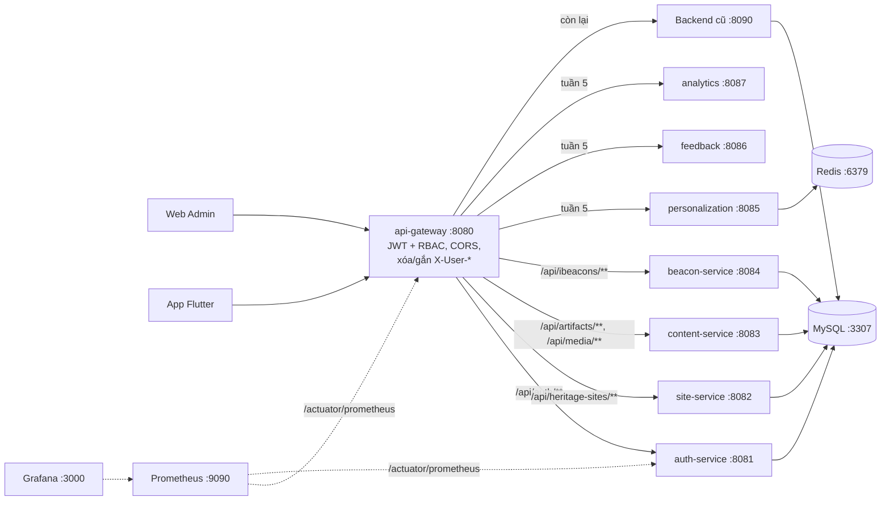

# Kiến trúc microservice Smart Heritage (Bảo – Sprint 4)

> Trạng thái: tuần 4. Tài liệu này mô tả kiến trúc đích và những gì đã chạy.
> Cách tách một service: xem [`services/README.md`](../../services/README.md).

## 1. Sơ đồ

## 2. Bảng service, cổng, schema

| Service | Cổng | Schema / bảng | Phụ trách | Trạng thái |
|---|---|---|---|---|
| api-gateway | 8080 | Không có DB | Bảo | Tuần 4 |
| auth-service | 8081 | auth_db: users, refresh_tokens (tuần 4 tạm dùng smart_heritage_db, xem mục 5) | Bảo | Tuần 4 |
| site-service | 8082 | site_db: heritage_sites | Ân | Tuần 4 |
| content-service | 8083 | content_db: artifacts, artifact_contents, media_resources | Xuân Anh | Tuần 4 |
| beacon-service | 8084 | beacon_db: ibeacons | Khoa | Tuần 4 |
| personalization-service | 8085 | personalization_db: visits, likes | Phú | Tuần 5 |
| feedback-service | 8086 | feedback_db: feedbacks | Tường | Tuần 5 |
| analytics-service | 8087 | analytics_db | Tuấn | Tuần 5 |
| Backend cũ (monolith) | 8090 | smart_heritage_db | Bảo | Giữ các API chưa tách |

## 3. Định tuyến tại Gateway

Khai báo trong `services/api-gateway/.../config/GatewayRoutesConfig.java`; địa chỉ đích trong `application.yml` (`app.routes.*`).
Service chưa tách → địa chỉ mặc định là Backend cũ, nên demo không gãy trong lúc tách.

| Thứ tự | Đường dẫn | Chuyển tới (biến môi trường) |
|---|---|---|
| 1 | `/api/auth/**` | auth-service (`AUTH_SERVICE_URL`) |
| 2 | `/api/heritage-sites/**` | site-service (`SITE_SERVICE_URL`) |
| 3 | `/api/artifacts/*/feedbacks`, `/api/feedbacks/**` | feedback (`FEEDBACK_SERVICE_URL`) – **phải trước dòng 4** |
| 4 | `/api/artifacts/**`, `/api/media/**` | content-service (`CONTENT_SERVICE_URL`) |
| 5 | `/api/ibeacons/**` | beacon-service (`BEACON_SERVICE_URL`) |
| 6 | `/api/me/**`, `/api/admin/visits/**`, `/api/users/**` | personalization (`PERSONALIZATION_SERVICE_URL`) |
| 7 | `/api/statistics/**` | analytics (`ANALYTICS_SERVICE_URL`) |
| 100 | còn lại | Backend cũ (`LEGACY_BACKEND_URL`) |

## 4. Xác thực khi đi qua Gateway

1. Client gửi `Authorization: Bearer <accessToken>` như tuần 3 (auth.js, AuthHttpClient không đổi).
2. Gateway kiểm tra token bằng `JwtService` (module common) và áp dụng luật trong `AccessRules.java`
   (chép từ `SecurityConfig` tuần 3): sai/thiếu token → **401**, không đủ quyền → **403**, trả ngay tại Gateway.
3. Gateway **xóa mọi header `X-User-*`** client tự gửi, rồi gắn `X-User-Id`, `X-User-Name`, `X-User-Role` từ token.
4. Service đọc người dùng bằng `CurrentUser` (module common). Service không tự kiểm tra JWT.
   Riêng Backend cũ vẫn tự kiểm tra JWT như tuần 3 (Gateway chuyển tiếp nguyên header `Authorization`).
5. Gateway, auth-service, Backend cũ dùng chung `JWT_SECRET`.

## 5. Quyết định tạm thời tuần 4 (cần xem lại ở tuần 5)

| Vấn đề | Tuần 4 | Hướng tuần 5 |
|---|---|---|
| Bảng `users` vẫn có khóa ngoại từ visits/likes/feedbacks trong smart_heritage_db | auth-service tạm trỏ `smart_heritage_db` (đổi bằng `AUTH_DB_URL`) để giữ tài khoản mẫu và khóa ngoại | Khi personalization/feedback tách (cột `Long userId`), chuyển users + refresh_tokens sang `auth_db` bằng script của Tường |
| Backend cũ còn `AuthController` | Không còn route tới (Gateway chuyển `/api/auth/**` sang auth-service) | Xóa sau khi tách xong |
| Swagger | Mỗi service một Swagger ở cổng riêng (8081–8087); Backend cũ ở 8090 | Gom về Gateway |
| Backend cũ chưa có Actuator | Prometheus chỉ đọc Gateway và các service mới | Không cần: Backend cũ sẽ bị thay dần |

## 6. Hạ tầng (Infra/docker-compose.yml)

| Profile | Gồm | Cổng |
|---|---|---|
| (không profile) | MySQL, Redis | 3307, 6379 |
| `core` | Backend cũ, auth-service, api-gateway (build từ mã nguồn) | 8090, 8081, 8080 |
| `mq` | RabbitMQ + giao diện quản trị | 5672, 15672 |
| `monitoring` | Prometheus, Grafana (đã nối sẵn nguồn Prometheus) | 9090, 3000 |
| `nifi` | Apache NiFi (Tuấn gắn luồng; driver JDBC đặt ở `Infra/nifi/drivers`) | 8443 |

Mật khẩu và khóa: copy `Infra/.env.example` thành `Infra/.env`.
