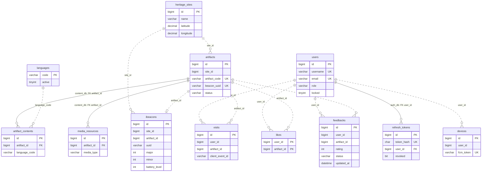

# Database Design Specification – Smart Heritage

| Mục | Nội dung |
|---|---|
| Người viết | Tường (Người 6) |
| Phiên bản | v1.0 (tuần 7) |
| Căn cứ | Script `Infra/db/00`–`08` trên `main`; bảng cột dưới đây sinh tự động từ `information_schema` của DB tạo bằng các script này |
| Hệ quản trị | MySQL 8, `utf8mb4` / `utf8mb4_unicode_ci`, InnoDB |

## 1. Nguyên tắc thiết kế

- **Mỗi microservice một schema, một user MySQL.** User chỉ có quyền trên schema của service mình
  (`00_create_schemas.sql`), nên một service không đọc hoặc sửa được dữ liệu của service khác.
- **Không có khoá ngoại chéo schema.** Cột trỏ sang dữ liệu của service khác chỉ là `BIGINT`
  (ví dụ `artifacts.site_id`, `feedbacks.user_id`). Cần kiểm tra thì service gọi REST tới service sở hữu dữ liệu
  (ví dụ feedback-service gọi content-service để kiểm tra hiện vật tồn tại). Khoá ngoại trong cùng schema vẫn giữ.
- **Id dữ liệu mẫu giống nhau giữa các schema:** user 1..4, di tích 1..2, hiện vật 1..3, beacon 1..4.
  Ví dụ hiện vật 1 là "Khuê Văn Các" ở `content_db`, `beacon_db`, `personalization_db`, `feedback_db`.
- **Chống trùng ở mức database:** khoá duy nhất cho dữ liệu mà người dùng có thể gửi lại
  (đánh giá, lượt tham quan offline, yêu thích, bản dịch), và bảng `processed_events` cho sự kiện RabbitMQ.
- **Dữ liệu thống kê tách riêng** ở `analytics_db`, được nạp theo lô bằng NiFi, nên truy vấn Dashboard
  không làm chậm các service nghiệp vụ.

## 2. Tổng quan schema

| Schema | Service sở hữu | Người phụ trách | Script | Bảng |
|---|---|---|---|---|
| `auth_db` | auth-service (8081) | Bảo | `01_auth.sql` | `users`, `refresh_tokens` |
| `site_db` | site-service (8082) | Ân | `02_site.sql` | `heritage_sites` |
| `content_db` | content-service (8083) | Xuân Anh | `03_content.sql`, `08_languages.sql` | `artifacts`, `artifact_contents`, `media_resources`, `languages`, `artifact_event_outbox` |
| `beacon_db` | beacon-service (8084) | Khoa | `04_beacon.sql` | `ibeacons`, `devices`, `processed_events` |
| `personalization_db` | personalization-service (8085) | Phú | `05_personalization.sql` | `visits`, `likes` |
| `feedback_db` | feedback-service (8086) | Tường | `06_feedback.sql` | `feedbacks` |
| `analytics_db` | analytics-service (8087), NiFi | Tuấn | `07_analytics.sql` | `fact_visits`, `fact_feedbacks`, `dim_artifact`, `dim_site`, `dim_user_lang`, `agg_daily_views`, `rt_daily_counters`, `rt_processed_events` |

`smart_heritage_db` (`99_init_db_legacy.sql`) là database của Backend cũ (monolith), giữ để chuyển đổi.
auth-service hiện vẫn đọc bảng `users`, `refresh_tokens` trong schema này (biến `AUTH_DB_URL`); cấu trúc hai bảng
giống hệt `auth_db`.

## 3. Sơ đồ ERD

Đường liền: khoá ngoại thật trong cùng schema. Đường đứt: tham chiếu logic chéo schema (chỉ là cột `BIGINT`, không có khoá ngoại).



`analytics_db` không có quan hệ với bảng nghiệp vụ ở mức database: NiFi chép dữ liệu sang, khoá chính `fact_*`
bằng đúng id của bảng nguồn (`fact_visits.visit_id = visits.id`, `fact_feedbacks.feedback_id = feedbacks.id`)
để chạy lại không nhân đôi.

## 4. Chi tiết bảng theo schema

Ký hiệu cột Khoá: PK khoá chính, UQ khoá duy nhất, IDX có chỉ mục (cột đầu của chỉ mục hoặc khoá ngoại).


### 4.1 `auth_db` – auth-service (8081)

Tài khoản, vai trò, trạng thái khoá và phiên đăng nhập (refresh token).

#### `users`

| Cột | Kiểu | Null | Mặc định | Khoá | Ý nghĩa |
|---|---|---|---|---|---|
| `id` | `bigint` | Không | — | PK (tự tăng) | Mã người dùng |
| `username` | `varchar(50)` | Không | — | UQ | Tên đăng nhập, duy nhất |
| `email` | `varchar(100)` | Không | — | UQ | Email, duy nhất |
| `password_hash` | `varchar(255)` | Không | — |  | Mật khẩu đã băm BCrypt |
| `full_name` | `varchar(100)` | Có | — |  | Họ tên hiển thị |
| `preferred_language` | `varchar(10)` | Có | `vi` |  | Ngôn ngữ ưa thích (`vi`, `en`...) |
| `role` | `varchar(20)` | Không | `VISITOR` |  | `VISITOR` hoặc `ADMIN` |
| `locked` | `tinyint(1)` | Không | `0` |  | Trạng thái tài khoản: 0 đang hoạt động, 1 bị khoá (tuần 7) |
| `created_at` | `datetime(6)` | Có | `CURRENT_TIMESTAMP(6)` |  | Thời điểm tạo |

#### `refresh_tokens`

| Cột | Kiểu | Null | Mặc định | Khoá | Ý nghĩa |
|---|---|---|---|---|---|
| `id` | `bigint` | Không | — | PK (tự tăng) | Mã bản ghi |
| `token_hash` | `char(64)` | Không | — | UQ | SHA-256 của refresh token (không lưu token gốc) |
| `user_id` | `bigint` | Không | — | IDX | Chủ token (FK `users.id`, xoá user thì xoá token) |
| `expires_at` | `datetime(6)` | Không | — |  | Hạn dùng |
| `revoked` | `bit(1)` | Không | `b'0'` |  | 1 = đã thu hồi (đăng xuất, khoá tài khoản) |
| `created_at` | `datetime(6)` | Không | — |  | Thời điểm cấp |


### 4.2 `site_db` – site-service (8082)

Di tích và toạ độ trên bản đồ.

#### `heritage_sites`

| Cột | Kiểu | Null | Mặc định | Khoá | Ý nghĩa |
|---|---|---|---|---|---|
| `id` | `bigint` | Không | — | PK (tự tăng) | Mã di tích |
| `name` | `varchar(150)` | Không | — |  | Tên di tích |
| `location` | `varchar(255)` | Có | — |  | Địa chỉ |
| `map_image_url` | `varchar(500)` | Có | — |  | Ảnh sơ đồ khu di tích (dùng đặt beacon) |
| `latitude` | `decimal(10,7)` | Có | — |  | Vĩ độ WGS-84 |
| `longitude` | `decimal(10,7)` | Có | — |  | Kinh độ WGS-84 |


### 4.3 `content_db` – content-service (8083)

Hiện vật, bản dịch theo ngôn ngữ, tài nguyên đa phương tiện, danh sách ngôn ngữ. `artifact_event_outbox` giữ sự kiện ArtifactUpdated, lưu cùng transaction với hiện vật rồi mới gửi lên RabbitMQ (mẫu outbox), nên không mất sự kiện khi RabbitMQ tạm tắt.

#### `artifacts`

| Cột | Kiểu | Null | Mặc định | Khoá | Ý nghĩa |
|---|---|---|---|---|---|
| `id` | `bigint` | Không | — | PK (tự tăng) | Mã hiện vật |
| `site_id` | `bigint` | Không | — | IDX | Di tích chứa hiện vật (tham chiếu `site_db`, không FK) |
| `name` | `varchar(200)` | Không | — |  | Tên hiện vật |
| `artifact_code` | `varchar(50)` | Có | — | UQ | Mã hiện vật nghiệp vụ, duy nhất |
| `category` | `varchar(50)` | Có | — |  | Loại hiện vật |
| `description` | `text` | Có | — |  | Mô tả chung |
| `thumbnail_url` | `varchar(1000)` | Có | — |  | Ảnh đại diện |
| `period` | `varchar(100)` | Có | — |  | Niên đại |
| `material` | `varchar(200)` | Có | — |  | Chất liệu |
| `dimensions` | `varchar(200)` | Có | — |  | Kích thước |
| `beacon_uuid` | `varchar(100)` | Có | — | UQ | UUID beacon gắn với hiện vật, duy nhất |
| `status` | `varchar(20)` | Không | `ACTIVE` |  | `ACTIVE` hoặc `INACTIVE` (du khách chỉ xem ACTIVE) |
| `created_at` | `datetime(6)` | Có | `CURRENT_TIMESTAMP(6)` |  | Thời điểm tạo |
| `updated_at` | `datetime(6)` | Có | `CURRENT_TIMESTAMP(6)` |  | Thời điểm sửa |

#### `artifact_contents`

| Cột | Kiểu | Null | Mặc định | Khoá | Ý nghĩa |
|---|---|---|---|---|---|
| `id` | `bigint` | Không | — | PK (tự tăng) | Mã bản dịch |
| `artifact_id` | `bigint` | Không | — | IDX | Hiện vật (FK `artifacts.id`) |
| `language_code` | `varchar(10)` | Không | — |  | Mã ngôn ngữ |
| `title` | `varchar(200)` | Có | — |  | Tiêu đề theo ngôn ngữ |
| `description` | `text` | Có | — |  | Nội dung thuyết minh |
| `audio_url` | `varchar(1000)` | Có | — |  | Audio thuyết minh |
| `video_url` | `varchar(1000)` | Có | — |  | Video |
| `image_urls` | `text` | Có | — |  | Danh sách URL ảnh, mỗi dòng 1 URL |
| `transcript` | `text` | Có | — |  | Lời thoại của audio/video |
| `created_at` | `datetime(6)` | Có | `CURRENT_TIMESTAMP(6)` |  | Thời điểm tạo |
| `updated_at` | `datetime(6)` | Có | `CURRENT_TIMESTAMP(6)` |  | Thời điểm sửa |

#### `media_resources`

| Cột | Kiểu | Null | Mặc định | Khoá | Ý nghĩa |
|---|---|---|---|---|---|
| `id` | `bigint` | Không | — | PK (tự tăng) | Mã tài nguyên |
| `artifact_id` | `bigint` | Không | — | IDX | Hiện vật (FK `artifacts.id`) |
| `media_type` | `varchar(20)` | Không | — |  | `IMAGE`, `AUDIO` hoặc `VIDEO` |
| `file_url` | `varchar(500)` | Không | — |  | Đường dẫn tệp |
| `caption` | `varchar(255)` | Có | — |  | Chú thích |

#### `languages`

| Cột | Kiểu | Null | Mặc định | Khoá | Ý nghĩa |
|---|---|---|---|---|---|
| `code` | `varchar(10)` | Không | — | PK | Mã ngôn ngữ (`vi`, `en`, `fr`...) |
| `name` | `varchar(100)` | Không | — |  | Tên hiển thị |
| `active` | `tinyint(1)` | Không | `1` |  | 1 = đang dùng, 0 = đã tắt |

#### `artifact_event_outbox`

| Cột | Kiểu | Null | Mặc định | Khoá | Ý nghĩa |
|---|---|---|---|---|---|
| `event_id` | `varchar(36)` | Không | — | PK | UUID của sự kiện ArtifactUpdated |
| `occurred_at` | `datetime(6)` | Không | — |  | Thời điểm hiện vật thay đổi |
| `payload` | `text` | Không | — |  | JSON của sự kiện (artifactId, siteId, changedFields...) |
| `published_at` | `datetime(6)` | Có | — | IDX | Thời điểm đã gửi lên RabbitMQ; NULL = chưa gửi |


### 4.4 `beacon_db` – beacon-service (8084)

iBeacon và hiện vật được gán, thiết bị nhận thông báo FCM, sự kiện RabbitMQ đã xử lý.

#### `ibeacons`

| Cột | Kiểu | Null | Mặc định | Khoá | Ý nghĩa |
|---|---|---|---|---|---|
| `id` | `bigint` | Không | — | PK (tự tăng) | Mã beacon |
| `site_id` | `bigint` | Không | — | IDX | Di tích đặt beacon (không FK) |
| `artifact_id` | `bigint` | Có | — | IDX | Hiện vật được gán, NULL = chưa gán (không FK) |
| `uuid` | `char(36)` | Không | — | IDX | UUID iBeacon |
| `major` | `int` | Không | — |  | Major 0–65535 |
| `minor` | `int` | Không | — |  | Minor 0–65535 |
| `x_coord` | `double` | Có | — |  | Toạ độ X trên ảnh sơ đồ |
| `y_coord` | `double` | Có | — |  | Toạ độ Y trên ảnh sơ đồ |
| `battery_level` | `int` | Có | — |  | Pin 0–100% |
| `battery_alerted_at` | `datetime(6)` | Có | — |  | Lần cảnh báo pin thấp gần nhất; xoá khi pin ≥ 20% |
| `status` | `varchar(20)` | Không | `ACTIVE` |  | `ACTIVE` hoặc `INACTIVE` |
| `created_at` | `datetime(6)` | Có | `CURRENT_TIMESTAMP(6)` |  | Thời điểm tạo |
| `updated_at` | `datetime(6)` | Có | `CURRENT_TIMESTAMP(6)`, tự cập nhật |  | Thời điểm sửa |

#### `devices`

| Cột | Kiểu | Null | Mặc định | Khoá | Ý nghĩa |
|---|---|---|---|---|---|
| `id` | `bigint` | Không | — | PK (tự tăng) | Mã thiết bị |
| `user_id` | `bigint` | Không | — | IDX | Người dùng sở hữu máy |
| `fcm_token` | `varchar(512)` | Không | — | UQ | Token FCM, duy nhất |
| `platform` | `varchar(20)` | Không | `unknown` |  | `android`, `ios`, `web` hoặc `unknown` |
| `created_at` | `datetime(6)` | Có | `CURRENT_TIMESTAMP(6)` |  | Thời điểm đăng ký |
| `updated_at` | `datetime(6)` | Có | `CURRENT_TIMESTAMP(6)`, tự cập nhật |  | Thời điểm cập nhật |

#### `processed_events`

| Cột | Kiểu | Null | Mặc định | Khoá | Ý nghĩa |
|---|---|---|---|---|---|
| `id` | `bigint` | Không | — | PK (tự tăng) | Mã bản ghi |
| `event_id` | `char(36)` | Không | — | UQ | eventId của sự kiện RabbitMQ đã xử lý (chống xử lý trùng) |
| `event_type` | `varchar(100)` | Không | — | IDX | Loại sự kiện |
| `processed_at` | `datetime(6)` | Có | `CURRENT_TIMESTAMP(6)` |  | Thời điểm xử lý |


### 4.5 `personalization_db` – personalization-service (8085)

Lịch sử tham quan và hiện vật yêu thích của du khách.

#### `visits`

| Cột | Kiểu | Null | Mặc định | Khoá | Ý nghĩa |
|---|---|---|---|---|---|
| `id` | `bigint` | Không | — | PK (tự tăng) | Mã lượt tham quan |
| `user_id` | `bigint` | Không | — | IDX | Du khách (không FK) |
| `artifact_id` | `bigint` | Không | — | IDX | Hiện vật (không FK) |
| `detected_at` | `datetime` | Không | `CURRENT_TIMESTAMP` |  | Thời điểm phát hiện ở gần hiện vật |
| `duration_seconds` | `int` | Có | — |  | Thời gian dừng, NULL = chưa biết |
| `client_event_id` | `varchar(36)` | Có | — |  | Mã sự kiện do app sinh, chống ghi trùng khi đồng bộ offline |
| `source` | `varchar(20)` | Không | `MANUAL` |  | Nguồn ghi: `BEACON`, `MAP` hoặc `MANUAL` |

#### `likes`

| Cột | Kiểu | Null | Mặc định | Khoá | Ý nghĩa |
|---|---|---|---|---|---|
| `user_id` | `bigint` | Không | — | PK | Du khách |
| `artifact_id` | `bigint` | Không | — | PK | Hiện vật được yêu thích |
| `saved_at` | `datetime` | Không | `CURRENT_TIMESTAMP` |  | Thời điểm bấm yêu thích |


### 4.6 `feedback_db` – feedback-service (8086)

Đánh giá của du khách và trạng thái kiểm duyệt.

#### `feedbacks`

| Cột | Kiểu | Null | Mặc định | Khoá | Ý nghĩa |
|---|---|---|---|---|---|
| `id` | `bigint` | Không | — | PK (tự tăng) | Mã đánh giá |
| `user_id` | `bigint` | Không | — | IDX | Người gửi (không FK) |
| `artifact_id` | `bigint` | Không | — | IDX | Hiện vật (không FK) |
| `reviewer_name` | `varchar(100)` | Có | — |  | Tên người gửi chụp lại lúc gửi |
| `rating` | `int` | Không | — |  | Số sao 1–5 |
| `comment` | `text` | Có | — |  | Bình luận |
| `status` | `varchar(20)` | Không | `PENDING` | IDX | `PENDING`, `APPROVED`, `REJECTED` |
| `created_at` | `datetime(6)` | Có | `CURRENT_TIMESTAMP(6)` |  | Thời điểm gửi lần đầu |
| `updated_at` | `datetime(6)` | Có | `CURRENT_TIMESTAMP(6)`, tự cập nhật | IDX | Đổi khi sửa hoặc đổi trạng thái; cột mốc của NiFi |


### 4.7 `analytics_db` – analytics-service (8087), NiFi

Kho thống kê: NiFi đổ dữ liệu theo lô vào `fact_*`, `dim_*`, `agg_*`; analytics-service đếm thời gian thực từ sự kiện RabbitMQ vào `rt_*`.

#### `fact_visits`

| Cột | Kiểu | Null | Mặc định | Khoá | Ý nghĩa |
|---|---|---|---|---|---|
| `visit_id` | `bigint` | Không | — | PK | = `visits.id` |
| `user_id` | `bigint` | Không | — |  | Du khách |
| `artifact_id` | `bigint` | Không | — | IDX | Hiện vật |
| `site_id` | `bigint` | Có | — | IDX | = `artifacts.site_id` |
| `language_code` | `varchar(10)` | Có | — |  | = `users.preferred_language` |
| `detected_at` | `datetime` | Không | — | IDX | Thời điểm tham quan |
| `duration_seconds` | `int` | Có | — |  | Thời gian dừng |
| `synced_at` | `datetime(6)` | Không | `CURRENT_TIMESTAMP(6)` |  | Lúc NiFi ghi vào |

#### `fact_feedbacks`

| Cột | Kiểu | Null | Mặc định | Khoá | Ý nghĩa |
|---|---|---|---|---|---|
| `feedback_id` | `bigint` | Không | — | PK | = `feedbacks.id` |
| `artifact_id` | `bigint` | Không | — | IDX | Hiện vật |
| `rating` | `int` | Không | — |  | Số sao 1–5 |
| `status` | `varchar(20)` | Không | — |  | Trạng thái kiểm duyệt |
| `created_at` | `datetime(6)` | Có | — |  | Thời điểm gửi |

#### `dim_artifact`

| Cột | Kiểu | Null | Mặc định | Khoá | Ý nghĩa |
|---|---|---|---|---|---|
| `artifact_id` | `bigint` | Không | — | PK | = `artifacts.id` |
| `code` | `varchar(50)` | Có | — |  | Mã hiện vật |
| `name` | `varchar(200)` | Không | — |  | Tên hiện vật |
| `site_id` | `bigint` | Có | — |  | Di tích |
| `site_name` | `varchar(150)` | Có | — |  | Tên di tích |

#### `dim_site`

| Cột | Kiểu | Null | Mặc định | Khoá | Ý nghĩa |
|---|---|---|---|---|---|
| `site_id` | `bigint` | Không | — | PK | = `heritage_sites.id` |
| `name` | `varchar(150)` | Không | — |  | Tên di tích |
| `location` | `varchar(255)` | Có | — |  | Địa chỉ |
| `latitude` | `decimal(10,7)` | Có | — |  | Vĩ độ |
| `longitude` | `decimal(10,7)` | Có | — |  | Kinh độ |

#### `dim_user_lang`

| Cột | Kiểu | Null | Mặc định | Khoá | Ý nghĩa |
|---|---|---|---|---|---|
| `user_id` | `bigint` | Không | — | PK | = `users.id` |
| `language_code` | `varchar(10)` | Không | `vi` |  | Ngôn ngữ của du khách |

#### `agg_daily_views`

| Cột | Kiểu | Null | Mặc định | Khoá | Ý nghĩa |
|---|---|---|---|---|---|
| `day` | `date` | Không | — | PK | Ngày |
| `views` | `int` | Không | `0` |  | Số lượt xem |
| `visitors` | `int` | Không | `0` |  | Số du khách khác nhau |

#### `rt_daily_counters`

| Cột | Kiểu | Null | Mặc định | Khoá | Ý nghĩa |
|---|---|---|---|---|---|
| `day` | `date` | Không | — | PK | Ngày |
| `artifact_id` | `bigint` | Không | — | PK | Hiện vật |
| `views` | `int` | Không | `0` |  | Lượt xem hôm nay |
| `feedbacks` | `int` | Không | `0` |  | Số đánh giá hôm nay |
| `rating_sum` | `int` | Không | `0` |  | Tổng số sao (để tính trung bình) |

#### `rt_processed_events`

| Cột | Kiểu | Null | Mặc định | Khoá | Ý nghĩa |
|---|---|---|---|---|---|
| `event_id` | `char(36)` | Không | — | PK | eventId đã xử lý |
| `event_type` | `varchar(50)` | Không | — |  | Loại sự kiện |
| `processed_at` | `datetime(6)` | Không | `CURRENT_TIMESTAMP(6)` |  | Thời điểm xử lý |


## 5. Khoá duy nhất, chỉ mục và ràng buộc kiểm tra

| Schema.bảng | Tên | Loại | Cột | Mục đích |
|---|---|---|---|---|
| `auth_db.users` | `uq_users_username`, `uq_users_email` | UNIQUE | `username`; `email` | Không trùng tài khoản |
| `auth_db.refresh_tokens` | `uq_refresh_tokens_hash` | UNIQUE | `token_hash` | Tra token khi làm mới phiên |
| `auth_db.refresh_tokens` | `fk_refresh_tokens_user` | FK, `ON DELETE CASCADE` | `user_id` → `users.id` | Xoá user thì xoá phiên |
| `content_db.artifacts` | `uq_artifacts_code`, `uq_artifacts_beacon` | UNIQUE | `artifact_code`; `beacon_uuid` | Mỗi mã, mỗi beacon chỉ thuộc 1 hiện vật |
| `content_db.artifacts` | `idx_artifacts_site` | INDEX | `site_id` | Lọc hiện vật theo di tích |
| `content_db.artifact_event_outbox` | `idx_artifact_outbox_pending` | INDEX | `published_at, occurred_at` | Tìm nhanh sự kiện chưa gửi, theo thứ tự thời gian |
| `content_db.artifact_contents` | `uq_artifact_language` | UNIQUE | `artifact_id, language_code` | Mỗi hiện vật 1 bản dịch cho 1 ngôn ngữ |
| `content_db.artifact_contents`, `media_resources` | `fk_artifact_contents_artifact`, `fk_media_resources_artifact` | FK | `artifact_id` → `artifacts.id` | Bản dịch, media gắn với hiện vật |
| `beacon_db.ibeacons` | `uq_ibeacons_identity` | UNIQUE | `uuid, major, minor` | Một bộ nhận dạng iBeacon chỉ có 1 bản ghi |
| `beacon_db.ibeacons` | `idx_ibeacons_site`, `idx_ibeacons_artifact` | INDEX | `site_id`; `artifact_id` | Lọc theo di tích, tra beacon của hiện vật |
| `beacon_db.ibeacons` | `chk_ibeacons_major`, `chk_ibeacons_minor`, `chk_ibeacons_battery` | CHECK | `major`, `minor` 0–65535; `battery_level` NULL hoặc 0–100 | Chặn dữ liệu sai |
| `beacon_db.devices` | `uq_devices_token`, `idx_devices_user` | UNIQUE, INDEX | `fcm_token`; `user_id` | 1 token chỉ thuộc 1 user; gửi thông báo theo user |
| `beacon_db.processed_events` | `uq_processed_events_event_id` | UNIQUE | `event_id` | Không xử lý 1 sự kiện RabbitMQ 2 lần |
| `personalization_db.visits` | `uq_visits_user_event` | UNIQUE | `user_id, client_event_id` | Đồng bộ offline gửi lại không ghi trùng |
| `personalization_db.visits` | `chk_visits_duration` | CHECK | `duration_seconds` NULL hoặc ≥ 0 | Chặn thời gian âm |
| `personalization_db.likes` | PRIMARY KEY | PK ghép | `user_id, artifact_id` | Mỗi người yêu thích 1 hiện vật 1 lần |
| `feedback_db.feedbacks` | `uq_feedbacks_user_artifact` | UNIQUE | `user_id, artifact_id` | Mỗi người 1 đánh giá cho 1 hiện vật (gửi lại = ghi đè, về `PENDING`) |
| `feedback_db.feedbacks` | `idx_feedbacks_artifact_status`, `idx_feedbacks_status` | INDEX | `artifact_id, status`; `status` | Đánh giá công khai của hiện vật, số chờ duyệt |
| `feedback_db.feedbacks` | `idx_feedbacks_updated_at` | INDEX | `updated_at` | NiFi lấy bản ghi mới/đổi trạng thái |
| `feedback_db.feedbacks` | `chk_feedbacks_rating` | CHECK | `rating` 1–5 | Chặn số sao sai |
| `analytics_db.fact_visits` | `idx_fact_visits_detected_at`, `_artifact`, `_site` | INDEX | `detected_at`; `artifact_id`; `site_id` | Lọc Dashboard theo ngày, hiện vật, di tích |
| `analytics_db.fact_feedbacks` | `idx_fact_feedbacks_artifact`, `chk_fact_feedbacks_rating` | INDEX, CHECK | `artifact_id`; `rating` 1–5 | Thống kê đánh giá theo hiện vật |

## 6. Dữ liệu mẫu

| Dữ liệu | Có ở | Ghi chú |
|---|---|---|
| 4 tài khoản: `admin` (ADMIN), `visitor_an`, `visitor_mai`, `visitor_john` (VISITOR) | `auth_db`, `smart_heritage_db` | Mật khẩu chung `Test@1234` (BCrypt), `locked = 0` |
| 2 di tích, 3 hiện vật, bản dịch `vi`/`en`, 3 media | `site_db`, `content_db` | Id giữ nguyên ở mọi schema |
| 4 beacon | `beacon_db` | 3 beacon gán hiện vật 1..3, 1 beacon chưa gán |
| 4 lượt tham quan, 3 yêu thích, 6 đánh giá | `personalization_db`, `feedback_db` | Đủ để chạy Test Plan |

Dữ liệu demo bản cuối (dữ liệu Xuân Anh nhập) sẽ là file seed riêng trong `Infra/db`.

## 7. Tạo lại và kiểm tra database

```bash
# Tạo lại từ đầu (XOÁ dữ liệu cũ)
docker compose -f Infra/docker-compose.yml down -v
docker compose -f Infra/docker-compose.yml up -d mysql-db

# Script có lỗi không
docker logs smart_heritage_mysql 2>&1 | grep -i error

# Đối chiếu cột thật với tài liệu này
docker exec smart_heritage_mysql mysql -uroot -prootpassword123 -e "SELECT TABLE_SCHEMA, TABLE_NAME, COLUMN_NAME, COLUMN_TYPE FROM information_schema.COLUMNS WHERE TABLE_SCHEMA LIKE '%_db' ORDER BY 1,2,ORDINAL_POSITION"
```

Thêm cột cho DB đang chạy mà không xoá dữ liệu: xem [`Infra/db/README.md`](../../Infra/db/README.md).

## 8. Lịch sử thay đổi

| Tuần | Thay đổi |
|---|---|
| 4 | Tách `smart_heritage_db` thành 7 schema theo service, bỏ khoá ngoại chéo schema; `feedbacks.reviewer_name`; `visits.client_event_id`, `source`; `analytics_db`: `fact_*`, `dim_artifact`, `agg_daily_views` |
| 5 | `feedbacks`: khoá `(user_id, artifact_id)`, cột `updated_at`; `analytics_db`: `dim_site`, `dim_user_lang`; `content_db.languages`; `beacon_db.devices` |
| 6 | `beacon_db`: `processed_events`, `ibeacons.battery_alerted_at`; `analytics_db`: `rt_daily_counters`, `rt_processed_events` |
| 7 | `users.locked` (trạng thái tài khoản) ở `auth_db` và `smart_heritage_db`; đưa `content_db.artifact_event_outbox` (có từ tuần 6, trước đây do service tự tạo) vào `03_content.sql` |
