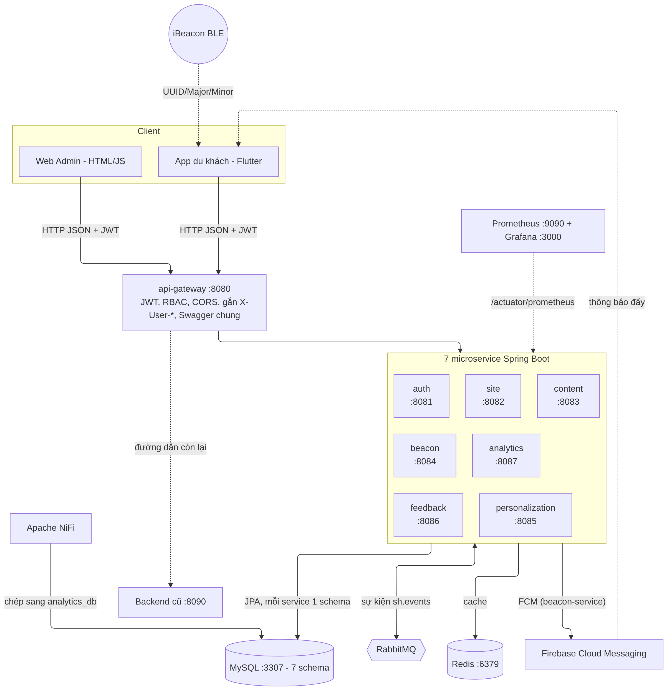

# Đặc tả yêu cầu phần mềm (SRS) – Smart Heritage

*Software Requirements Specification – An iBeacon-Based Smart Tourism System for Interactive Experiences at Historical and Cultural Heritage Sites*

| Mục | Nội dung |
|---|---|
| Phiên bản | Bản cuối – Sprint 7 (XDPMHDT-96). Thay cho `SmartHeritage_SRS.docx` (bản 07/11/2026, theo `main` 96feac5) |
| Căn cứ trạng thái | `main` = `c365dac` (13/11/2026) và 4 patch tuần 7 (`W7_01`–`W7_04`, chờ merge) |
| Kho mã nguồn | https://github.com/Hoifbao/XDPMHDT |
| Thành viên | Đỗ Lê Hoài Bảo, Đoàn Phương Thiên Ân, Nguyễn Phạm Xuân Anh, Nguyễn Huỳnh Đăng Khoa, Huỳnh Thiên Phú, Võ Duy Tường, Nguyễn Thanh Tuấn |
| Người tổng hợp | Đỗ Lê Hoài Bảo |

## 1. Giới thiệu

### 1.1 Mục đích tài liệu

Tài liệu đặc tả các yêu cầu chức năng và phi chức năng của Smart Heritage, làm căn cứ chung để thiết kế, lập trình, kiểm thử và nghiệm thu. Yêu cầu người dùng ở dạng nghiệp vụ nằm trong [URS](URS.md); tài liệu này chi tiết hoá chúng thành yêu cầu phần mềm có mã truy vết.

Đối tượng đọc: 7 thành viên nhóm, giảng viên hướng dẫn và hội đồng đánh giá.

### 1.2 Phạm vi sản phẩm

Smart Heritage gồm ứng dụng di động cho du khách, trang quản trị web cho ban quản lý, hệ thống REST API (7 microservice sau API Gateway) và hạ tầng iBeacon. Khi du khách đến gần hiện vật có gắn iBeacon, ứng dụng tự nhận diện và hiển thị nội dung đa phương tiện, đa ngôn ngữ mà không cần quét QR. Ban quản lý dùng trang web để quản lý nội dung, thiết bị, người dùng, phản hồi và xem thống kê.

Trong phạm vi: xác thực, phân quyền và quản lý người dùng; di tích, hiện vật, đa phương tiện, đa ngôn ngữ; quản lý iBeacon và nhận diện tự động; bản đồ tương tác; yêu thích, lịch sử, xem ngoại tuyến; đánh giá và kiểm duyệt; thông báo đẩy; thống kê và xuất báo cáo; đóng gói Docker, giám sát.

Ngoài phạm vi: định vị trong nhà theo mét, AR, gợi ý bằng AI, dịch máy, thanh toán vé.

### 1.3 Thuật ngữ

| Thuật ngữ | Giải thích |
|---|---|
| iBeacon | Chuẩn quảng bá Bluetooth Low Energy của Apple. Thiết bị chỉ phát tín hiệu, điện thoại nghe và nhận diện |
| BLE | Bluetooth Low Energy |
| UUID / Major / Minor | Bộ định danh iBeacon: UUID chung của hệ thống, Major là khu vực (di tích), Minor là từng thiết bị |
| RSSI | Cường độ tín hiệu nhận được (dBm); −60 dBm gần hơn −90 dBm |
| Cooldown / hysteresis | Khoảng chặn hiển thị lặp cùng hiện vật; ngưỡng vào/ra khác nhau để tránh nhảy qua lại |
| JWT | JSON Web Token chứa userId, role, có chữ ký |
| RBAC | Phân quyền theo vai trò (VISITOR, ADMIN) |
| API Gateway | Cổng duy nhất (8080) mà Web, Mobile gọi vào; kiểm JWT, phân quyền, chuyển tiếp |
| Sự kiện (event) | Thông điệp gửi qua RabbitMQ (exchange `sh.events`) khi dữ liệu thay đổi, để service khác cập nhật |
| DLQ | Dead-letter queue – hàng chứa tin xử lý lỗi nhiều lần |
| Fallback ngôn ngữ | Thiếu bản dịch theo ngôn ngữ yêu cầu thì trả bản tiếng Việt |
| Haversine | Công thức tính khoảng cách hai điểm theo vĩ độ, kinh độ |
| p95 | 95% request có thời gian phản hồi không vượt giá trị này |

### 1.4 Tài liệu tham khảo

- Đề tài Smart Heritage (bối cảnh, user story, yêu cầu phi chức năng, sản phẩm bàn giao); Task.docx (kế hoạch 8 tuần); Task_main.docx (phân công).
- [URS](URS.md), [Kiến trúc](../architecture/architecture.md), [Deployment Guide](../deployment/deployment-guide.md).
- Lược đồ CSDL `Infra/db/00`–`08_*.sql`; Swagger chung `http://localhost:8080/swagger-ui.html`.
- `Docs/testing/test-plan.md`, `Docs/testing/test-report.md`, [kiểm thử tải](../testing/load-test-w7.md).
- IEEE Std 830-1998 (khung trình bày).

### 1.5 Quy ước

Mã yêu cầu: `FR-<nhóm>-nn` (chức năng), `NFR-nn` (phi chức năng), `UC-nn` (ca sử dụng). Ưu tiên: **Cao** (bắt buộc cho demo), **Trung bình** (cần có), **Thấp** (nếu kịp).

Cột Trạng thái: **Đã có** = có trong code trên `main` `c365dac`; **W7 (chờ merge)** = đã viết trong patch tuần 7, chưa vào `main`; **Một phần** = có nhưng chưa đủ tiêu chí; **Chưa làm**. "Đã có" chưa đồng nghĩa test case đã đạt trên thiết bị thật; kết quả kiểm thử ghi ở Test Report.

## 2. Mô tả tổng quan

### 2.1 Bối cảnh và vấn đề

- Di tích chủ yếu dùng bảng thông tin, tờ rơi, hướng dẫn viên; du khách tiếp nhận thụ động, nhất là giới trẻ và khách quốc tế.
- Thông tin phần lớn chỉ có tiếng Việt; mã QR buộc quét thủ công từng hiện vật, không cá nhân hoá theo vị trí.
- Ban quản lý thiếu nền tảng tích hợp để quản lý nội dung, thiết bị và số liệu; quyết định dựa vào quan sát.

### 2.2 Kiến trúc tổng thể

| Khối | Công nghệ | Vai trò |
|---|---|---|
| Mobile App (du khách) | Flutter (Android, iOS, Web) | Đăng nhập, quét iBeacon, xem hiện vật, bản đồ, yêu thích, lịch sử, đánh giá, xem offline, nhận thông báo FCM |
| Web Admin | HTML, CSS, JavaScript; Chart.js; Leaflet | Menu chung; quản lý di tích, hiện vật, beacon, phản hồi, người dùng; Dashboard, xuất báo cáo |
| API Gateway | Spring Cloud Gateway (cổng 8080) | Định tuyến, kiểm JWT, RBAC, CORS, Swagger chung |
| 7 microservice | Spring Boot 3.5.6, Java 17+, Spring Data JPA, springdoc-openapi, Micrometer | Mỗi service một cổng (8081–8087) và một schema riêng |
| Dữ liệu | MySQL 8 (7 schema), Redis 7.2, Apache NiFi | Lưu trữ; cache; NiFi tổng hợp dữ liệu sang `analytics_db` |
| Sự kiện | RabbitMQ 3.13 (exchange `sh.events`, DLQ) | Đồng bộ bất đồng bộ giữa các service |
| Hạ tầng | Docker Compose (profile `core`, `mq`, `monitoring`, `nifi`, `all`); Prometheus, Grafana, exporter | Chạy toàn hệ thống, giám sát và cảnh báo |
| Thiết bị | iBeacon BLE (thật hoặc giả lập) | Phát UUID/Major/Minor |

Sơ đồ, luồng xác thực, luồng sự kiện và luồng NiFi: xem [tài liệu Kiến trúc](../architecture/architecture.md).

| Service | Cổng | Schema | Đường dẫn qua Gateway | Phụ trách |
|---|---|---|---|---|
| api-gateway | 8080 | – | Mọi `/api/**`; `/swagger-ui.html` | Bảo |
| auth-service | 8081 | smart_heritage_db (bảng users, refresh_tokens; `auth_db` đã có script nhưng chưa chuyển – mục 9) | `/api/auth/**`, `/api/admin/users/**` | Bảo |
| site-service | 8082 | site_db | `/api/heritage-sites/**` | Ân |
| content-service | 8083 | content_db | `/api/artifacts/**`, `/api/media/**`, `/api/languages`, `/api/admin/languages/**` | Xuân Anh |
| beacon-service | 8084 | beacon_db | `/api/ibeacons/**`, `/api/me/devices/**` | Khoa |
| personalization-service | 8085 | personalization_db | `/api/me/**`, `/api/admin/visits/**`, `/api/users/**` | Phú |
| feedback-service | 8086 | feedback_db | `/api/artifacts/*/feedbacks`, `/api/artifacts/*/rating-summary`, `/api/admin/feedbacks/**`, `/api/feedbacks/**` (đặt trước content-service) | Tường |
| analytics-service | 8087 | analytics_db | `/api/statistics/**` | Tuấn |
| Backend cũ | 8090 | smart_heritage_db | Các đường dẫn còn lại (dự phòng) | – |

### 2.3 Chức năng chính

- **Ứng dụng du khách:** tự nhận diện hiện vật qua iBeacon; xem mô tả, ảnh, audio, video theo ngôn ngữ; bản đồ; yêu thích; lịch sử; xem tiếp khi rời vùng beacon hoặc mất mạng; gửi đánh giá; nhận thông báo khi đánh giá được duyệt.
- **Bộ máy trải nghiệm tương tác:** dò BLE liên tục, chọn beacon gần nhất, chống thông báo lặp, kích hoạt nội dung khi sang vùng mới.
- **CMS nội dung:** quản lý di tích, hiện vật, media, bản dịch, ngôn ngữ mà không phải cập nhật ứng dụng.
- **Quản lý iBeacon:** đăng ký, gán hiện vật, vị trí trên bản đồ, trạng thái, pin và cảnh báo pin yếu.
- **Thống kê và báo cáo:** KPI, top hiện vật, xu hướng, ngôn ngữ, phản hồi; số liệu hôm nay theo thời gian thực; xuất PDF/Excel.
- **Nền tảng quản trị:** menu chung, quản lý người dùng (vai trò, khoá tài khoản), kiểm duyệt phản hồi.

### 2.4 Tác nhân

| Tác nhân | Mô tả |
|---|---|
| Visitor | Du khách dùng ứng dụng di động |
| Administrator | Ban quản lý dùng Web Admin; vai trò ADMIN |
| System | Tiến trình tự động trên ứng dụng và máy chủ (dò beacon, đồng bộ, xử lý sự kiện, NiFi) |

### 2.5 Môi trường vận hành

- Mobile: Android 8.0+ (ưu tiên kiểm thử Android 12+), iOS 15+, BLE 4.0. Chạy thử trên Chrome (không có iBeacon thật).
- Web Admin: Chrome, Edge, Firefox bản mới; màn hình từ 1280 px.
- Máy chủ: Docker Desktop (Compose v2). Cách 1 – toàn bộ trong Docker: `docker compose -f Infra/docker-compose.yml --profile all up -d --build`. Cách 2 – phát triển: JDK 17+ (đã chạy JDK 25), Maven, `Infra/dev/start-local.ps1` mở 9 cửa sổ (Backend cũ, Gateway, 7 service). Chi tiết: [Deployment Guide](../deployment/deployment-guide.md).
- Giám sát: Prometheus 9090, Grafana 3000; RabbitMQ UI 15672; NiFi 8443.
- Thiết bị: iBeacon thật hoặc điện thoại phát iBeacon giả lập, UUID `E2C56DB5-DFFB-48D2-B060-D0F5A71096E0`.

### 2.6 Ràng buộc thiết kế và triển khai

- 8 tuần theo Agile/Scrum (mỗi tuần một sprint, quản lý trên Jira dự án XDPMHDT); thiết kế theo UML 2.0.
- API RESTful, JSON, tài liệu hoá bằng OpenAPI/Swagger; client chỉ gọi qua Gateway. Khung JSON chung `{ success, message, data }` (riêng auth-service trả JSON phẳng).
- Service phía sau không tự kiểm JWT: Gateway xoá header `X-User-*` client gửi, gắn lại `X-User-Id`, `X-User-Name`, `X-User-Role` từ token.
- Mỗi service sở hữu một schema; không truy vấn chéo schema, không khoá ngoại xuyên schema; tên bảng, cột `snake_case`.
- Đồng bộ giữa service: REST khi cần kết quả ngay; sự kiện RabbitMQ khi chỉ cần báo thay đổi.
- Git: nhánh từ `main` mới nhất, rebase khi `main` đổi; mọi thay đổi qua Pull Request, chỉ squash merge; tiêu đề PR dạng `XDPMHDT-<số>: <mô tả>`; ruleset `protect-main` chặn force-push, xoá nhánh, bắt check `history-guard`.
- Bí mật (mật khẩu DB, khoá JWT, khoá Firebase) đặt trong biến môi trường hoặc `Infra/.env`, không đưa lên Git.
- Trên iOS, iBeacon chỉ đọc được qua CoreLocation.

### 2.7 Giả định và phụ thuộc

- Di tích có mạng di động hoặc Wi-Fi cơ bản; mất mạng thì dùng dữ liệu đã cache.
- Mỗi hiện vật gắn tối đa một beacon ACTIVE; beacon cùng di tích đặt đủ xa để hạn chế chồng vùng.
- Bản đồ dùng OpenStreetMap (Leaflet trên Web, flutter_map trên Mobile); thông báo đẩy dùng Firebase Cloud Messaging.
- Nội dung do ban quản lý cung cấp; bản demo dùng dữ liệu mẫu.

## 3. Yêu cầu chức năng

### 3.1 Xác thực, người dùng và quản trị (auth-service, Web Admin)

| Mã | Yêu cầu | Tác nhân | Ưu tiên | Tiêu chí chấp nhận | Trạng thái |
|---|---|---|---|---|---|
| FR-AUTH-01 | Đăng ký tài khoản du khách (username, email, mật khẩu, họ tên) | Visitor | Cao | Email hợp lệ; mật khẩu ≥ 6 ký tự; trùng username/email → 400; mật khẩu lưu BCrypt | Đã có |
| FR-AUTH-02 | Đăng nhập trên Mobile và Web | Visitor, Admin | Cao | Đúng → thông tin người dùng + token; sai → 401 | Đã có |
| FR-AUTH-03 | Cấp access token và refresh token; làm mới; đăng xuất | System | Cao | Access 15 phút, refresh 7 ngày, dùng 1 lần; đăng xuất thu hồi refresh token | Đã có |
| FR-AUTH-04 | Phân quyền RBAC VISITOR, ADMIN tại Gateway | System | Cao | Thiếu/sai token → 401; sai vai trò → 403 | Đã có (`AccessRules`) |
| FR-AUTH-05 | Xem và cập nhật hồ sơ, ngôn ngữ ưu tiên | Visitor | Trung bình | Ngôn ngữ ưu tiên dùng làm mặc định khi lấy nội dung | Một phần (xem `/api/auth/me`; chưa có API sửa hồ sơ) |
| FR-AUTH-06 | Quản lý người dùng: danh sách phân trang, tìm theo username/email/họ tên, lọc vai trò, đổi vai trò, khoá/mở khoá | Admin | Cao (yêu cầu Đề tài – module 6, Task Package 1) | Chỉ ADMIN gọi được, VISITOR → 403; không tự khoá hoặc tự đổi vai trò; tài khoản bị khoá: đăng nhập và refresh → 403, mọi refresh token bị thu hồi | W7 (chờ merge – patch 01 API, patch 02 trang `users.html`) |
| FR-AUTH-07 | Bảo vệ trang quản trị (route guard) | Admin | Cao | Chưa đăng nhập hoặc không phải ADMIN → về trang đăng nhập | Đã có (`auth.js`) |
| FR-ADM-01 | Menu quản trị chung và trang Tổng quan số liệu thật | Admin | Cao | Mọi trang dùng chung menu: Tổng quan, Di tích, Hiện vật, Beacon, Phản hồi, Người dùng, Tài khoản, Đăng xuất; trang đang mở được đánh dấu; số đánh giá chờ duyệt hiện cạnh Phản hồi | W7 (chờ merge – patch 02) |

### 3.2 Di tích và bản đồ (site-service)

| Mã | Yêu cầu | Tác nhân | Ưu tiên | Tiêu chí chấp nhận | Trạng thái |
|---|---|---|---|---|---|
| FR-SITE-01 | Thêm, sửa, xoá, xem di tích (tên, địa chỉ, ảnh bản đồ, toạ độ) | Admin | Cao | lat −90..90, lng −180..180; tên trùng → lỗi | Đã có |
| FR-SITE-02 | Chọn toạ độ trên bản đồ trong form | Admin | Trung bình | Bấm bản đồ tự điền toạ độ | Đã có (Leaflet + OSM) |
| FR-SITE-03 | Tìm di tích gần vị trí hiện tại | Visitor | Trung bình | Trong bán kính, sắp xếp gần → xa (Haversine) | Đã có (`/nearby`, ≤ 50 km) |
| FR-SITE-04 | Bản đồ tương tác trên Mobile | Visitor | Cao | Marker di tích; bấm mở tóm tắt, danh sách hiện vật; nút chỉ đường | Một phần (marker di tích, di tích gần, chỉ đường; chưa có marker hiện vật) |

### 3.3 Hiện vật, đa phương tiện, đa ngôn ngữ (content-service)

| Mã | Yêu cầu | Tác nhân | Ưu tiên | Tiêu chí chấp nhận | Trạng thái |
|---|---|---|---|---|---|
| FR-ART-01 | Thêm, sửa, xoá, xem, tìm kiếm hiện vật thuộc một di tích | Admin | Cao | Mã hiện vật duy nhất; di tích phải tồn tại (hỏi site-service) | Đã có |
| FR-ART-02 | Nội dung theo ngôn ngữ (tiêu đề, mô tả, audio, video, ảnh, transcript); quản lý danh mục ngôn ngữ | Admin | Cao | Mỗi hiện vật tối đa 1 bản / ngôn ngữ; bật/tắt ngôn ngữ | Đã có |
| FR-ART-03 | Lấy nội dung theo ngôn ngữ, fallback tiếng Việt | Visitor | Cao | `lang=en` trả tiếng Anh; thiếu bản dịch trả tiếng Việt kèm cờ `fallback` | Đã có |
| FR-ART-04 | Upload media có giới hạn định dạng, dung lượng | Admin | Trung bình | Ảnh ≤ 10 MB, audio ≤ 30 MB, video ≤ 100 MB; sai → từ chối | Đã có |
| FR-ART-05 | Form CMS "3 trong 1": thông tin + media + bản dịch | Admin | Cao | Tạo xong hiện vật 2 ngôn ngữ trong một màn hình | Đã có (`artifacts.html`) |
| FR-ART-06 | Màn hình chi tiết trên Mobile: trình phát audio/video, đổi ngôn ngữ | Visitor | Cao | Đổi ngôn ngữ tự tải lại; rời màn hình dừng phát | Đã có |
| FR-ART-07 | Phát sự kiện khi hiện vật thay đổi, có xác nhận gửi | System | Trung bình | Tạo/sửa/xoá hiện vật → `artifact.updated`; RabbitMQ tắt thì giữ trong outbox và gửi lại | Đã có (#53) |

### 3.4 iBeacon, nhận diện và thông báo (beacon-service, Mobile)

| Mã | Yêu cầu | Tác nhân | Ưu tiên | Tiêu chí chấp nhận | Trạng thái |
|---|---|---|---|---|---|
| FR-BCN-01 | Đăng ký, sửa, xoá, xem iBeacon | Admin | Cao | UUID đúng định dạng; Major/Minor 0–65535; bộ (UUID, Major, Minor) không trùng | Đã có |
| FR-BCN-02 | Gán / bỏ gán beacon cho hiện vật | Admin | Cao | Chỉ gán hiện vật cùng di tích | Đã có |
| FR-BCN-03 | Mobile tải danh sách beacon ACTIVE (registry) | System | Cao | Trả uuid, major, minor, artifactId; cập nhật khi hiện vật đổi (`artifact.updated`) | Đã có |
| FR-BCN-04 | Quét BLE, đọc UUID/Major/Minor/RSSI; xin quyền | System | Cao | Đọc beacon thật hoặc giả lập; có màn hình xin quyền | Đã có trong code (bằng chứng thiết bị thật: Khoa, tuần 7) |
| FR-BCN-05 | Phân giải beacon → hiện vật và hiển thị | Visitor | Cao | Vào vùng → hiện nội dung ≤ 2 giây | Một phần (chưa có bảng đo ≤ 2 giây sau sửa) |
| FR-BCN-06 | Lọc nhiễu, chọn beacon mạnh nhất, ngưỡng vào/ra, cooldown | System | Cao | Đứng yên không hiện lại; 2 beacon cách 2–3 m không nhảy qua lại | Một phần (RSSI trung bình 5 lần, vào −75 / ra −85 dBm, cooldown 60 giây; xử lý chồng vùng, mất sóng, tắt Bluetooth: tuần 7) |
| FR-BCN-07 | Vị trí beacon trên bản đồ, theo dõi pin, cảnh báo pin yếu | Admin | Trung bình | Pin < 20% → cảnh báo trên Web và thông báo FCM tới admin | Đã có (#65: `PUT /{id}/battery`, `POST /battery-check`, sự kiện `beacon.battery.low`) |
| FR-BCN-08 | Thông báo đẩy FCM khi đánh giá của du khách được duyệt | System | Trung bình | Admin duyệt → điện thoại du khách nhận thông báo; không gửi trùng cùng sự kiện | Đã có trong code (#62); demo trên điện thoại thật: XDPMHDT-64, tuần 7 |

### 3.5 Cá nhân hoá và ngoại tuyến (personalization-service, Mobile)

| Mã | Yêu cầu | Tác nhân | Ưu tiên | Tiêu chí chấp nhận | Trạng thái |
|---|---|---|---|---|---|
| FR-PER-01 | Thêm, bỏ, xem hiện vật yêu thích | Visitor | Trung bình | Thêm 2 lần không trùng; chỉ thấy dữ liệu của mình | Đã có |
| FR-PER-02 | Ghi và xem lịch sử tham quan (BEACON, MAP, MANUAL) | Visitor, System | Trung bình | Mới nhất trước, phân trang; ghi lượt → sự kiện `visit.recorded` | Đã có |
| FR-PER-03 | Đồng bộ lượt xem ghi lúc mất mạng theo lô | System | Trung bình | Gửi lại cùng `clientEventId` không sinh bản ghi trùng | Đã có (`POST /api/me/visits/batch`) |
| FR-PER-04 | Xem tiếp nội dung khi rời vùng beacon hoặc mất mạng | Visitor | Cao | Tắt mạng vẫn mở được hiện vật đã xem, có nhãn bản đã tải | Đã có (kiểm thử rớt mạng giữa chừng: Phú, Xuân Anh – tuần 7) |
| FR-PER-05 | Cache Redis cho dữ liệu đọc nhiều | System | Thấp | Lần đọc sau nhanh hơn; xoá cache khi hiện vật đổi | Đã có ở personalization (snapshot hiện vật, TTL 10 phút, xoá theo `artifact.updated`); content-service chưa cache (issue W7 #4) |

### 3.6 Đánh giá và phản hồi (feedback-service)

| Mã | Yêu cầu | Tác nhân | Ưu tiên | Tiêu chí chấp nhận | Trạng thái |
|---|---|---|---|---|---|
| FR-FB-01 | Gửi đánh giá 1–5 sao kèm bình luận | Visitor | Trung bình | Ngoài 1–5 → 400; mới ở trạng thái PENDING; gửi lại thì ghi đè (200); phát `feedback.created` | Đã có |
| FR-FB-02 | Xem đánh giá đã duyệt, điểm trung bình; "Đánh giá của tôi" | Visitor | Trung bình | Chỉ APPROVED hiện công khai; điểm TB chỉ tính APPROVED | Đã có (`/rating-summary`, `/api/feedbacks/me`) |
| FR-FB-03 | Kiểm duyệt: duyệt, từ chối, lọc theo trạng thái, hiện vật; đếm số chờ duyệt | Admin | Trung bình | Đổi trạng thái lưu CSDL; duyệt → `feedback.approved` | Đã có (`/pending-count`); chưa lọc theo số sao |
| FR-FB-04 | Chống spam | System | Thấp | Vượt giới hạn trả lỗi rõ | Một phần (1 đánh giá / người / hiện vật; chưa lọc từ cấm) |

### 3.7 Thống kê và báo cáo (analytics-service, NiFi)

| Mã | Yêu cầu | Tác nhân | Ưu tiên | Tiêu chí chấp nhận | Trạng thái |
|---|---|---|---|---|---|
| FR-ANA-01 | Dashboard KPI: lượt xem, khách duy nhất, điểm TB, số phản hồi, thời gian dừng TB | Admin | Cao | Khớp dữ liệu nguồn; tải ≤ 5 giây | Đã có (`/overview`, dữ liệu NiFi; đo ≤ 5 giây với dữ liệu lớn: Tuấn, tuần 7) |
| FR-ANA-02 | Biểu đồ: top hiện vật, xu hướng theo ngày, ngôn ngữ, đánh giá; lọc ngày và di tích | Admin | Cao | Lọc được theo khoảng ngày và di tích | Một phần (đủ trừ phân bố số sao) |
| FR-ANA-03 | Xuất báo cáo PDF, Excel theo bộ lọc | Admin | Trung bình | File đúng số liệu đang lọc; PDF đúng tiếng Việt | Đã có (#61: `GET /export?format=xlsx|pdf`; Excel 4 sheet) |
| FR-ANA-04 | Số liệu "Hôm nay" theo thời gian thực | Admin | Thấp | Lượt xem, đánh giá mới tăng ngay khi có sự kiện | Đã có (#60: `/realtime`, nhận `visit.recorded`, `feedback.created`) |

### 3.8 Đồng bộ bằng sự kiện (RabbitMQ)

| Mã | Sự kiện | Bên gửi → Bên nhận | Mục đích | Trạng thái |
|---|---|---|---|---|
| FR-EVT-01 | `artifact.updated` | content → personalization, beacon | Xoá cache hiện vật; làm mới registry | Đã có |
| FR-EVT-02 | `visit.recorded` | personalization → analytics | Cộng số liệu thời gian thực | Đã có |
| FR-EVT-03 | `feedback.created` | feedback → analytics | Đếm đánh giá mới | Đã có |
| FR-EVT-04 | `feedback.approved` | feedback → beacon | Gửi FCM cho du khách | Đã có |
| FR-EVT-05 | `beacon.battery.low` | beacon → beacon (thông báo admin) | Gửi FCM cảnh báo pin | Đã có |

Yêu cầu chung: bên nhận chống xử lý trùng theo `eventId`; tin lỗi nhiều lần vào DLQ (`sh.events.dlx`); có metric `sh_events_published_total{type, result}`. Đã kiểm thử đủ 5 sự kiện chạy thật (chốt code tuần 6).

## 4. Yêu cầu phi chức năng

| Mã | Nhóm | Yêu cầu | Cách kiểm tra | Hiện trạng |
|---|---|---|---|---|
| NFR-01 | Hiệu năng | Hiện thông tin hiện vật ≤ 2 giây sau khi vào vùng beacon | Đo ≥ 20 lần trên điện thoại thật | Chưa có số đo sau sửa (Khoa, tuần 7) |
| NFR-02 | Hiệu năng | ≥ 95% request API ≤ 2 giây; Dashboard ≤ 5 giây | k6 qua Gateway; đo Dashboard | k6 lần 1 (13/11, 500 VU): p95 toàn bộ 1,09 giây; chi tiết hiện vật 1,55 giây. Lần 2: [load-test-w7](../testing/load-test-w7.md) |
| NFR-03 | Khả dụng | Thao tác chính trong 3–5 lần chạm; Web responsive | Thử với người dùng; nhiều kích thước màn hình | Đang sửa giao diện chặn demo (patch W7 02, 03) |
| NFR-04 | Bảo mật | HTTPS/TLS ≥ 1.2; BCrypt; RBAC; không ghi log mật khẩu, token | Rà cấu hình; kiểm thử 401/403 | RBAC, BCrypt đạt; HTTPS khi triển khai server (tuần 8) |
| NFR-05 | Mở rộng | ≥ 500 người dùng đồng thời; nhiều di tích, hàng nghìn hiện vật, hàng trăm beacon | k6 500 VU | Lần 1 đạt ngưỡng; nghẽn pool kết nối DB ở content-service (10/10 bận, tới 124 request chờ) |
| NFR-06 | Sẵn sàng | ≥ 99% trong giờ vận hành; mất beacon vẫn xem nội dung đã tải | Giám sát uptime; tắt Bluetooth, tắt mạng | Cảnh báo ServiceDown; xem offline có trong app |
| NFR-07 | Tin cậy | Không báo lặp; đồng bộ không mất, không trùng; tự phục hồi sau gián đoạn | Kịch bản chống lặp, đồng bộ lại; outbox sự kiện | Chống trùng `clientEventId`, `eventId`; outbox content-service |
| NFR-08 | Bảo trì | Module rõ ràng (Controller – Service – Repository); Swagger đủ API; cấu hình qua biến môi trường | Review; Swagger chung | Đạt |
| NFR-09 | Pin, tài nguyên | Chỉ quét BLE khi ứng dụng mở | Đo pin 30 phút tham quan | Chưa đo |
| NFR-10 | Giám sát | Metric Prometheus cho Gateway và service; 8 cảnh báo (ServiceDown, MySQLDown, RedisDown, HighErrorRate5xx, HighLatencyP95, RabbitMQDown, RabbitMQQueueBacklog, RabbitMQDeadLetter); dashboard Grafana | `smoke-test.ps1`; tắt một service xem cảnh báo | Đạt (site-service chưa bật histogram p95 – issue W7 #7) |
| NFR-11 | Kiểm thử hồi quy | Bộ E2E qua Gateway phủ 7 service, chạy nhiều vòng không lỗi, tự dọn dữ liệu | Newman ≥ 3 vòng, 0 assertion lỗi | Đạt lúc chốt code W6: 231 request, 369 assertion, 0 lỗi |
| NFR-12 | Triển khai | Máy sạch (chỉ cài Docker) chạy toàn hệ thống bằng 1 lệnh trong ≤ 15 phút | Tuấn chạy thử máy sạch theo Deployment Guide | W7 (patch 04, chờ merge và chạy thử) |

## 5. Yêu cầu dữ liệu

MySQL 8 chia 7 schema theo service (`Infra/db/00`–`08_*.sql`). Không có khoá ngoại xuyên schema; `user_id`, `site_id`, `artifact_id` ở service khác là tham chiếu logic, kiểm tra qua REST. Toàn bộ dùng `utf8mb4`.

| Bảng (schema) | Mô tả | Cột chính |
|---|---|---|
| users (smart_heritage_db*) | Tài khoản | id, username, email, password_hash, full_name, preferred_language, role, **locked** (W7), created_at |
| refresh_tokens (smart_heritage_db*) | Refresh token (lưu dạng băm) | id, token_hash, user_id, expires_at, created_at |
| heritage_sites (site_db) | Di tích | id, name, location, map_image_url, latitude, longitude |
| artifacts (content_db) | Hiện vật | id, site_id, name, artifact_code, category, description, thumbnail_url, period, material, dimensions, status, created_at, updated_at |
| artifact_contents (content_db) | Nội dung theo ngôn ngữ | id, artifact_id, language_code, title, description, audio_url, video_url, image_urls, transcript; duy nhất (artifact_id, language_code) |
| media_resources (content_db) | Media | id, artifact_id, media_type, file_url, caption |
| languages (content_db) | Ngôn ngữ | code, name, active |
| ibeacons (beacon_db) | Thiết bị iBeacon | id, site_id, artifact_id, uuid, major, minor, x_coord, y_coord, battery_level, status; duy nhất (uuid, major, minor) |
| devices, processed_events (beacon_db) | Token FCM; sự kiện đã xử lý | user_id, fcm_token, platform; event_id |
| visits, likes (personalization_db) | Lượt tham quan; yêu thích | user_id, artifact_id, detected_at, duration_seconds, client_event_id, source; khoá (user_id, artifact_id) |
| feedbacks (feedback_db) | Đánh giá | id, user_id, artifact_id, reviewer_name, rating 1–5, comment, status, created_at |
| fact_*, dim_*, agg_daily_views, rt_* (analytics_db) | Kho số liệu (NiFi nạp) và bộ đếm thời gian thực | fact_visits, fact_feedbacks, dim_artifact, dim_site, dim_user_lang, agg_daily_views, rt_processed_events, rt_daily_counters |

\* auth-service hiện vẫn trỏ `smart_heritage_db` (biến `AUTH_DB_URL`, mặc định trong `application.yml` và `docker-compose.yml`) để giữ tài khoản mẫu; `Infra/db/01_auth.sql` tạo sẵn `auth_db` cùng cấu trúc. Cột `locked` do Hibernate tự thêm vào bảng đang dùng; cần bổ sung vào cả `01_auth.sql` và `99_init_db_legacy.sql` cho khớp tài liệu.

Ràng buộc: rating 1–5; major, minor 0–65535; battery_level 0–100; phản hồi PENDING/APPROVED/REJECTED; hiện vật, beacon ACTIVE/INACTIVE; `locked` mặc định 0.

Dữ liệu mẫu: tài khoản `admin`, `visitor_an`, `visitor_mai`, `visitor_john` (mật khẩu `Test@1234`); di tích, hiện vật, beacon, nội dung vi/en. Bộ dữ liệu demo bản cuối (kèm media) do Xuân Anh nhập, Tường xuất thành file seed (tuần 7).

ERD chi tiết: tài liệu 05_ERD_Database (Tường).

## 6. Yêu cầu giao diện

### 6.1 Giao diện người dùng

| Nền tảng | Màn hình | Phụ trách |
|---|---|---|
| Web Admin | Đăng nhập, đăng ký, hồ sơ; menu chung; Tổng quan; Người dùng | Bảo |
| Web Admin | Di tích (form có bản đồ) | Ân |
| Web Admin | Hiện vật "3 trong 1" | Xuân Anh |
| Web Admin | iBeacon, bản đồ beacon, pin | Khoa |
| Web Admin | Kiểm duyệt phản hồi | Tường |
| Web Admin | Dashboard, xuất báo cáo | Tuấn |
| Mobile | Đăng nhập, đăng ký, hồ sơ, ngôn ngữ; trang chủ | Bảo |
| Mobile | Bản đồ, di tích gần, chỉ đường | Ân |
| Mobile | Danh sách, chi tiết hiện vật, audio/video | Xuân Anh |
| Mobile | Xin quyền, quét beacon, thông báo | Khoa |
| Mobile | Yêu thích, lịch sử, xem offline | Phú |
| Mobile | Chấm sao, đánh giá của tôi | Tường |

### 6.2 Giao diện phần mềm (REST API qua Gateway `http://<máy chủ>:8080`)

Luật phân quyền tại Gateway (xét từ trên xuống): `OPTIONS` cho qua → `POST /api/auth/register|login|refresh|logout` công khai → `/api/auth/me`, `/api/auth/users/**` cần đăng nhập → `/api/users/{userId}/**` chính chủ hoặc ADMIN → `/api/me/**` cần đăng nhập → `/api/admin/**` chỉ ADMIN → `POST /api/artifacts/{id}/feedbacks` VISITOR hoặc ADMIN → `/api/statistics/**` chỉ ADMIN → `GET /api/**` công khai → ghi `/api/**` chỉ ADMIN.

| Service | Endpoint | Mô tả | Quyền | Trạng thái |
|---|---|---|---|---|
| auth | `POST /api/auth/register`, `/login`, `/refresh`, `/logout` | Đăng ký, đăng nhập, làm mới, đăng xuất | Public | Đã có |
| auth | `GET /api/auth/me`; `GET /api/auth/users/{id}` | Hồ sơ | Đăng nhập | Đã có |
| auth | `GET /api/admin/users`; `PATCH /api/admin/users/{id}/role`; `PATCH /api/admin/users/{id}/status` | Quản lý người dùng | ADMIN | W7 (patch 01) |
| site | `GET, POST /api/heritage-sites`; `GET, PUT, DELETE /api/heritage-sites/{id}`; `GET /nearby?lat=&lng=&radius=` | Di tích, di tích gần | GET public; ghi ADMIN | Đã có |
| content | `GET, POST /api/artifacts`; `GET /batch?ids=`; `GET, PUT, DELETE /api/artifacts/{id}?lang=` | Hiện vật | GET public; ghi ADMIN | Đã có |
| content | `GET, POST /api/artifacts/{id}/contents`; `GET …/contents/{lang}`; `DELETE /api/artifacts/contents/{contentId}` | Nội dung đa ngôn ngữ | GET public; ghi ADMIN | Đã có |
| content | `GET, POST /api/artifacts/{id}/media`; `DELETE /api/media/{mediaId}`; `POST /api/media/upload`; `GET /api/media/files/{name}` | Media | GET public; ghi ADMIN | Đã có |
| content | `GET /api/languages`; `GET, POST /api/admin/languages`; `PUT /api/admin/languages/{code}` | Ngôn ngữ | Public / ADMIN | Đã có |
| beacon | `GET, POST /api/ibeacons`; `GET, PUT, DELETE /api/ibeacons/{id}`; `GET /registry`; `POST /{id}/assign`; `PUT /{id}/position`; `PUT /{id}/battery`; `POST /battery-check` | iBeacon, registry, vị trí, pin | GET public; ghi ADMIN | Đã có |
| beacon | `POST, GET, DELETE /api/me/devices`; `POST /api/me/devices/test` | Token FCM, thông báo thử | Đăng nhập | Đã có |
| personalization | `GET /api/me/favorites`; `POST, DELETE /api/me/favorites/{artifactId}`; `GET …/{artifactId}/exists` | Yêu thích | Đăng nhập | Đã có |
| personalization | `GET, POST /api/me/visits`; `POST /api/me/visits/batch`; `GET /api/admin/visits` | Lịch sử, đồng bộ offline | Đăng nhập / ADMIN | Đã có |
| feedback | `POST, GET /api/artifacts/{id}/feedbacks`; `GET /api/artifacts/{id}/rating-summary`; `GET /api/feedbacks/me` | Gửi, xem đánh giá | POST VISITOR/ADMIN; GET public; `/me` đăng nhập | Đã có |
| feedback | `GET /api/admin/feedbacks?status=&artifactId=`; `GET /pending-count`; `PATCH /api/admin/feedbacks/{id}/status` | Kiểm duyệt | ADMIN | Đã có |
| analytics | `GET /api/statistics/overview?top=&siteId=&from=&to=`; `GET /realtime`; `GET /export?format=xlsx\|pdf` | Dashboard, thời gian thực, xuất báo cáo | ADMIN | Đã có |

Tài liệu đầy đủ từng API: Swagger chung tại Gateway và tài liệu 06_API_Docs (Tường).

### 6.3 Giao diện phần cứng

- Gói iBeacon: UUID (16 byte), Major (2 byte), Minor (2 byte), TX power (1 byte); chu kỳ phát 100–1000 ms.
- Android 12+ cần quyền `BLUETOOTH_SCAN`, `ACCESS_FINE_LOCATION`; iOS cần `NSLocationWhenInUseUsageDescription`.

### 6.4 Giao diện hệ thống ngoài

OpenStreetMap (Leaflet, flutter_map); Firebase Cloud Messaging; MySQL; Redis; RabbitMQ; Apache NiFi; Prometheus/Grafana. File media lưu trên máy chủ (thư mục `MEDIA_DIRECTORY` của content-service).

## 7. Đặc tả ca sử dụng chính

.png>)

.png>)

### UC-01 – Tự nhận diện hiện vật qua iBeacon

| Mục | Nội dung |
|---|---|
| Tác nhân | Visitor, System |
| Tiền điều kiện | Đã đăng nhập; đã cấp quyền Bluetooth, vị trí; đã tải registry |
| Luồng chính | 1. Mở màn quét, tải `GET /api/ibeacons/registry`. 2. Vào vùng beacon; lọc theo UUID hệ thống. 3. Chọn beacon mạnh nhất (RSSI trung bình) vượt ngưỡng vào −75 dBm. 4. Kiểm tra cooldown. 5. Tra artifactId, gọi `GET /api/artifacts/{id}?lang=`. 6. content-service trả nội dung (fallback vi). 7. Hiện thông báo, mở chi tiết; rời vùng thì ghi lượt (`POST /api/me/visits`, source BEACON) → `visit.recorded` |
| Ngoại lệ | 4a. Vừa hiển thị: bỏ qua. 5a. Mất mạng: dùng cache, lượt xem vào hàng đợi, đồng bộ sau. 3a. Chồng vùng: chỉ đổi khi beacon mới mạnh hơn ổn định qua nhiều lần đọc. *. Từ chối quyền: hướng dẫn bật quyền, vẫn xem hiện vật qua bản đồ |
| Hậu điều kiện | Nội dung hiện ≤ 2 giây; lượt tham quan được ghi |

### UC-02 – Admin tạo hiện vật và gán iBeacon

| Mục | Nội dung |
|---|---|
| Tác nhân | Administrator |
| Tiền điều kiện | Đã đăng nhập ADMIN; di tích, beacon đã có |
| Luồng chính | 1. Menu Hiện vật → form, chọn di tích, nhập mã, tên, niên đại, chất liệu. 2. Thêm media. 3. Nhập bản dịch vi, en. 4. Lưu; phát `artifact.updated`. 5. Menu Beacon, chọn beacon cùng di tích, gán. 6. Kiểm cùng di tích rồi lưu |
| Ngoại lệ | 4a. Trùng mã: báo lỗi, giữ dữ liệu. 6a. Khác di tích: từ chối. 2a. File sai định dạng/dung lượng: từ chối file |
| Hậu điều kiện | Hiện vật đủ 2 ngôn ngữ, được gán beacon |

### UC-03 – Gửi đánh giá và kiểm duyệt

| Mục | Nội dung |
|---|---|
| Tác nhân | Visitor, Administrator |
| Luồng chính | 1. Du khách chọn 1–5 sao, nhập bình luận. 2. Lưu PENDING; `feedback.created`; Web Admin tăng số chờ duyệt. 3. Admin lọc chờ duyệt. 4. Duyệt hoặc từ chối. 5. Duyệt → hiện công khai, tính vào điểm TB; `feedback.approved` → FCM tới du khách |
| Ngoại lệ | 1a. Đã đánh giá: ghi đè, về PENDING (200). 1b. Ngoài 1–5: 400 |
| Hậu điều kiện | Chỉ đánh giá đã duyệt hiển thị công khai |

### UC-04 – Xem Dashboard và xuất báo cáo

| Mục | Nội dung |
|---|---|
| Tác nhân | Administrator |
| Luồng chính | 1. Menu Tổng quan, chọn khoảng ngày, di tích. 2. Truy vấn số liệu tổng hợp (NiFi) và số liệu hôm nay. 3. Hiện KPI, biểu đồ. 4. Bấm Xuất PDF/Excel. 5. Tải file theo bộ lọc |
| Ngoại lệ | 2a. Không có dữ liệu: trạng thái rỗng |
| Hậu điều kiện | Admin có số liệu và file báo cáo |

### UC-05 – Quản lý người dùng (mới, tuần 7)

| Mục | Nội dung |
|---|---|
| Tác nhân | Administrator |
| Tiền điều kiện | Đã đăng nhập ADMIN |
| Luồng chính | 1. Menu Người dùng. 2. Hệ thống trả danh sách phân trang. 3. Admin tìm theo tên/email, lọc vai trò. 4. Đổi vai trò hoặc khoá/mở khoá. 5. Khoá → thu hồi mọi refresh token của tài khoản đó |
| Ngoại lệ | 4a. Tự khoá hoặc tự đổi vai trò chính mình: từ chối. 4b. Tài khoản bị khoá đăng nhập hoặc refresh: 403 |
| Hậu điều kiện | Tài khoản bị khoá không dùng được hệ thống cho tới khi mở khoá |

## 8. Kế hoạch thực hiện

| Tuần | Mục tiêu | Kết quả chính |
|---|---|---|
| 1 | Khởi tạo, thiết kế | SRS, UML, ERD, kiến trúc |
| 2 | Cơ sở hạ tầng | Repo, Docker MySQL/Redis, CRUD cơ bản, Swagger, đăng nhập |
| 3 | Tính năng cốt lõi (1) | JWT + RBAC, đa ngôn ngữ, CMS, API iBeacon, module quét BLE |
| 4 | Tính năng cốt lõi (2) | API Gateway, tách service, quản lý iBeacon trên Web, luồng quét → hiển thị |
| 5 | Tính năng nâng cao | Tách đủ 7 service, thống kê, kiểm duyệt, bản đồ, audio/video, Prometheus/Grafana, NiFi |
| 6 | Hoàn thiện chức năng | RabbitMQ (5 sự kiện), FCM, xuất PDF/Excel, lịch sử, yêu thích, cảnh báo, k6 500 VU, System Test lần 1 |
| 7 | Tích hợp, sửa lỗi | Sửa lỗi, quản lý người dùng, menu Web Admin, edge case beacon/mạng, Docker đủ 7 service, tài liệu, tag v1.0 |
| 8 | Bàn giao, bảo vệ | Triển khai server + HTTPS, video demo, User Manual, Final Report |

## 9. Vấn đề mở

| STT | Vấn đề | Hướng xử lý | Người chốt |
|---|---|---|---|
| 1 | Chưa có API sửa hồ sơ (FR-AUTH-05) | Ghi rõ trong báo cáo là ngoài phạm vi v1.0 nếu không kịp tuần 7 | Bảo |
| 2 | API demo Redis `/api/cache/demo` không có route riêng ở Gateway (rơi về Backend cũ) | Chỉ gọi thẳng cổng 8085 khi demo, hoặc thêm route | Phú + Bảo |
| 3 | Bản đồ Mobile chưa có marker hiện vật (FR-SITE-04) | Chấp nhận: vào hiện vật qua danh sách của di tích | Ân |
| 4 | Lọc đánh giá theo số sao, phân bố số sao trên Dashboard | Ngoài phạm vi v1.0 | Tường, Tuấn |
| 5 | HTTPS (NFR-04) | Bật khi triển khai server tuần 8 | Bảo |
| 6 | auth-service vẫn dùng `smart_heritage_db`, chưa chuyển sang `auth_db` (NiFi cũng đọc `users` từ `smart_heritage_db`) | Giữ nguyên cho v1.0 (tránh mất tài khoản mẫu sát hạn); ghi rõ trong tài liệu DB và báo cáo | Bảo + Tường |
| 7 | Sơ đồ UML, ERD còn bản tuần 1 ở vài chỗ | Người vẽ cập nhật cho tài liệu 04_UML, 05_ERD (hạn T4 18/11) | Theo task_w7 |

## Phụ lục A. Ma trận truy vết

| User story trong Đề tài | URS | SRS |
|---|---|---|
| Visitor đăng ký, đăng nhập | UR-01 | FR-AUTH-01, 02, 03 |
| Visitor cập nhật hồ sơ, chọn ngôn ngữ | UR-02 | FR-AUTH-05, FR-ART-03 |
| Visitor xem bản đồ tương tác | UR-03 | FR-SITE-03, 04 |
| Visitor được tự nhận diện hiện vật | UR-04 | FR-BCN-03 → 05, UC-01 |
| Visitor nhận nội dung đa phương tiện | UR-05 | FR-ART-02, 06 |
| Visitor xem tiếp khi rời vùng beacon | UR-06 | FR-PER-04 |
| Visitor lưu yêu thích, xem lịch sử | UR-07 | FR-PER-01, 02 |
| Visitor đánh giá, phản hồi | UR-08 | FR-FB-01, 02, FR-BCN-08, UC-03 |
| Admin đăng nhập an toàn | UR-09 | FR-AUTH-02, 04, 07 |
| Admin dùng nền tảng quản trị thống nhất, quản lý người dùng | UR-10, UR-11 | FR-ADM-01, FR-AUTH-06, UC-05 |
| Admin quản lý di tích, hiện vật | UR-12 | FR-SITE-01, 02, FR-ART-01, 05 |
| Admin quản lý media, bản dịch | UR-13 | FR-ART-02, 04, 05 |
| Admin quản lý ngôn ngữ | UR-14 | FR-ART-02, 03 |
| Admin đăng ký, cấu hình, gán iBeacon | UR-15 | FR-BCN-01, 02, UC-02 |
| Admin quản lý vị trí beacon trên bản đồ | UR-16 | FR-BCN-07 |
| Admin kiểm duyệt phản hồi | UR-17 | FR-FB-03 |
| Admin xem Dashboard | UR-18 | FR-ANA-01, 02, 04, UC-04 |
| Admin xuất PDF/Excel | UR-19 | FR-ANA-03 |
| System dò beacon, chống lặp, chuyển vùng | UR-20, UR-21 | FR-BCN-04, 06, NFR-07 |
| System đồng bộ app và nền tảng | UR-22 | FR-PER-03, FR-EVT-01 → 05 |
| System ghi nhận tương tác cho thống kê | UR-23 | FR-PER-02, FR-ANA-01 |
| System phục vụ đa ngôn ngữ | UR-02 | FR-ART-03 |
| System lưu trữ an toàn | UR-24 | FR-AUTH-04, NFR-04 |

## Phụ lục B. Thay đổi so với SRS bản 07/11/2026

- Cập nhật trạng thái theo `main` `c365dac` và patch tuần 7.
- Thêm: FR-ADM-01 (menu chung), nội dung FR-AUTH-06 (quản lý người dùng), FR-ART-07, FR-BCN-08, FR-ANA-04, nhóm FR-EVT (RabbitMQ), NFR-12 (triển khai 1 lệnh), UC-05.
- Chuyển trạng thái: FR-BCN-07 (cảnh báo pin), FR-PER-05 (cache Redis), FR-ANA-03 (xuất báo cáo) sang Đã có.
- Bổ sung API: `/api/admin/users/**`, `/battery`, `/battery-check`, `/pending-count`, `/api/feedbacks/me`, `/realtime`, `/export`.
- Đóng vấn đề mở cũ: start-local thiếu beacon/analytics (giải quyết bằng patch W7 04), quản lý tài khoản (patch W7 01, 02), đặt tên bảng, tách service, lưu media.
