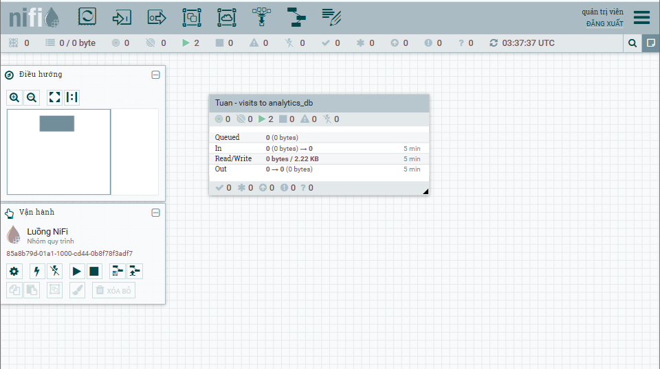
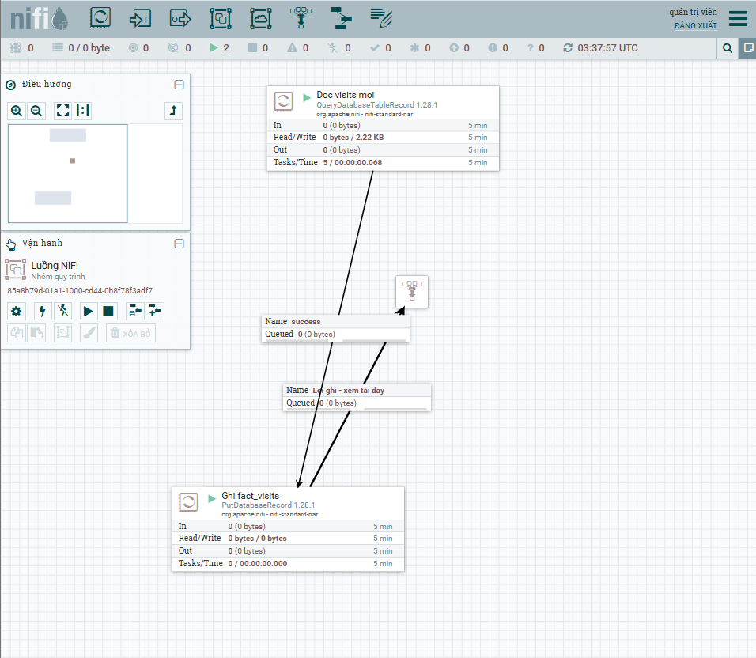
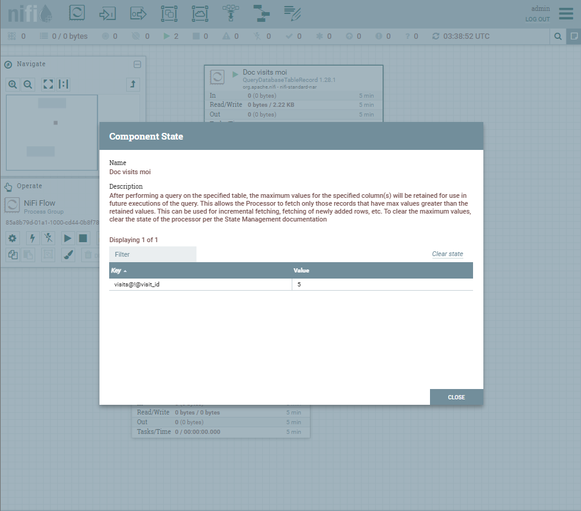
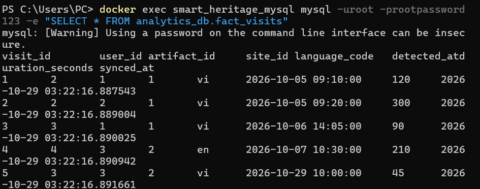

# Dựng Apache NiFi và luồng thống kê `visits` → `analytics_db`

> Người viết: Nguyễn Thanh Tuấn (mảng Dashboard Thống kê & Xuất báo cáo), Sprint 4.
> Đã chạy thử trên máy Windows 11 + Docker Desktop ngày 29/10/2026.
> Tài liệu nền: [api-gateway-nifi.md](api-gateway-nifi.md) (tìm hiểu NiFi ở Sprint 2).

## 1. Luồng làm gì

Đọc **dòng mới** của bảng `visits` trong DB nghiệp vụ và chép sang bảng `fact_visits` của `analytics_db`. Dashboard và analytics-service (tuần 5) sẽ đọc từ `analytics_db` thay vì đếm lại bảng nghiệp vụ.

```
smart_heritage_db                                         analytics_db
┌──────────────────────┐   ┌──────────────────────────┐   ┌──────────────────┐
│ visits               │   │ [Doc visits moi]         │   │                  │
│  + artifacts.site_id ├──>│ QueryDatabaseTableRecord ├──>│ [Ghi fact_visits]├──> fact_visits
│  + users.preferred_  │   │ 60 giây/lần, visit_id >  │   │ PutDatabaseRecord│
│    language          │   │ id lớn nhất đã đồng bộ   │   │ UPSERT           │
└──────────────────────┘   └──────────────────────────┘   └────────┬─────────┘
                                                                   │ failure / retry
                                                                   ▼
                                                     Funnel "Loi ghi - xem tai day"
```

Process group trên màn hình chính NiFi (tam giác xanh: 2 processor đang chạy):



Bên trong process group:



## 2. Các file liên quan

| File | Nội dung |
|---|---|
| `Infra/docker-compose.yml` | Service `nifi` trong profile `nifi` (Bảo dựng): `apache/nifi:1.28.1`, cổng 8443 |
| `Infra/.env.example` | `NIFI_USERNAME`, `NIFI_PASSWORD`, `MYSQL_ROOT_PASSWORD` |
| `Infra/nifi/drivers/` | Chỗ đặt MySQL JDBC driver (file `.jar` không commit) |
| `Infra/nifi/sql/07_analytics.sql` | Tạo `analytics_db` và 4 bảng (bản gửi Tường ghép vào `Infra/db/`) |
| `Infra/nifi/flows/visits-to-analytics.json` | Flow NiFi đã xuất, dùng để import |

## 3. Yêu cầu máy

- Docker Desktop đang chạy. NiFi dùng khoảng **1,2 GB RAM** (heap tối đa 1 GB, cấu hình sẵn trong compose).
- Máy nên có từ 8 GB RAM. Chỉ bật profile `nifi` khi cần, làm xong thì tắt.
- Lần đầu kéo image `apache/nifi:1.28.1` khoảng 1,5 GB.

## 4. Các bước dựng lại trên máy khác (PowerShell, ở thư mục gốc repo)

### Bước 1: Lấy code và (tùy chọn) tạo `.env`

```powershell
git pull
Copy-Item Infra/.env.example Infra/.env   # tùy chọn; không có .env thì dùng mật khẩu mặc định
```

### Bước 2: Tải MySQL JDBC driver

```powershell
Invoke-WebRequest -Uri https://repo1.maven.org/maven2/com/mysql/mysql-connector-j/8.4.0/mysql-connector-j-8.4.0.jar -OutFile Infra/nifi/drivers/mysql-connector-j-8.4.0.jar
```

Flow đang trỏ đúng tên file `mysql-connector-j-8.4.0.jar`. Dùng bản khác thì sửa tham số `driver_location` ở Bước 6.

### Bước 3: Bật MySQL, Redis và NiFi

```powershell
docker compose -f Infra/docker-compose.yml --profile nifi up -d
```

NiFi cần khoảng 30–60 giây để khởi động.

### Bước 4: Tạo `analytics_db`

Khi Tường chưa merge script chia schema (`Infra/db/`), chạy tay:

```powershell
docker cp Infra/nifi/sql/07_analytics.sql smart_heritage_mysql:/tmp/07_analytics.sql
docker exec smart_heritage_mysql sh -c "mysql -uroot -prootpassword123 < /tmp/07_analytics.sql"
```

Script chạy lại nhiều lần không lỗi (`CREATE ... IF NOT EXISTS`). Không dùng `Get-Content | docker exec` vì PowerShell 5.1 làm hỏng tiếng Việt khi chuyển qua pipe.

### Bước 5: Đăng nhập NiFi và import flow

1. Mở <https://localhost:8443/nifi>. Trình duyệt báo chứng chỉ không tin cậy (NiFi tự ký): chọn **Advanced → Proceed**.
2. Đăng nhập `admin` / `change-me-nifi-123` (hoặc giá trị `NIFI_USERNAME`, `NIFI_PASSWORD` trong `Infra/.env`).
3. Kéo biểu tượng **Process Group** ở thanh công cụ trên cùng thả vào màn hình.
4. Trong hộp thoại, bấm biểu tượng **Browse** (mũi tên tải lên) bên phải ô tên, chọn file `Infra/nifi/flows/visits-to-analytics.json`, bấm **Add**.

### Bước 6: Nhập mật khẩu DB

File flow **không chứa mật khẩu** (NiFi bỏ giá trị nhạy cảm khi xuất).

1. Chuột phải vào process group **Tuan - visits to analytics_db** → **Parameters**.
2. Sửa `db_password` = mật khẩu MySQL (`rootpassword123` hoặc `MYSQL_ROOT_PASSWORD` trong `Infra/.env`) → **Apply**.

| Tham số | Giá trị mặc định | Ghi chú |
|---|---|---|
| `source_db_url` | `jdbc:mysql://mysql-db:3306/smart_heritage_db?useSSL=false&allowPublicKeyRetrieval=true` | `mysql-db` là tên service trong compose, không dùng `localhost` |
| `analytics_db_url` | `jdbc:mysql://mysql-db:3306/analytics_db?useSSL=false&allowPublicKeyRetrieval=true` | |
| `db_user` | `root` | Tạm thời; đổi sang user riêng khi Tường tạo `00_create_schemas.sql` |
| `db_password` | (trống, phải nhập) | Nhạy cảm |
| `driver_location` | `/opt/nifi/nifi-current/drivers/mysql-connector-j-8.4.0.jar` | Đường dẫn bên trong container |

### Bước 7: Bật và chạy

1. Chuột phải vào process group → **Enable all controller services**.
2. Chuột phải lần nữa → **Start**.

### Bước 8: Kiểm tra kết quả

```powershell
docker exec smart_heritage_mysql mysql -uroot -prootpassword123 -e "SELECT * FROM analytics_db.fact_visits"
```

Với dữ liệu mẫu của `init_db.sql` phải thấy 4 dòng (`visit_id` 1–4).

### Tắt NiFi khi xong

```powershell
docker compose -f Infra/docker-compose.yml --profile nifi stop nifi
```

Flow được lưu trong volume `nifi_conf`, bật lại không phải import lại. Chỉ mất khi chạy `down -v`.

## 5. Cấu hình chính của flow

| Thành phần | Thuộc tính | Giá trị | Lý do |
|---|---|---|---|
| Doc visits moi (`QueryDatabaseTableRecord`) | Custom Query | `SELECT v.id AS visit_id, v.user_id, v.artifact_id, a.site_id, u.preferred_language AS language_code, v.detected_at, v.duration_seconds FROM visits v LEFT JOIN artifacts a ... LEFT JOIN users u ...` | `visits` không có `site_id`, `language_code` nên lấy kèm từ `artifacts`, `users` |
| | Table Name | `visits` | NiFi dùng làm khóa lưu trạng thái |
| | Maximum-value Columns | `visit_id` | Chỉ đọc dòng có `visit_id` lớn hơn lần trước |
| | Use Avro Logical Types | `true` | Giữ `DATETIME` đúng kiểu thời gian, không lệch giờ |
| | Run Schedule | `60 sec` | |
| Ghi fact_visits (`PutDatabaseRecord`) | Statement Type | `UPSERT` | Trùng `visit_id` thì cập nhật, không thêm dòng |
| | Table Name | `fact_visits` | |
| | Unmatched Column Behavior | `Ignore Unmatched Columns` | Cột `synced_at` do MySQL tự điền |
| Controller services | `MySQL nguon - smart_heritage_db`, `MySQL dich - analytics_db` (`DBCPConnectionPool`), `Avro writer`, `Avro reader` | | 2 kết nối riêng cho nguồn và đích |

### Chống nhân đôi dữ liệu (2 lớp)

1. **Trạng thái NiFi:** processor nhớ `visit_id` lớn nhất đã đọc (xem: chuột phải processor → **View state**). Lần sau chỉ đọc `visit_id` lớn hơn.
   
2. **Khóa chính `fact_visits.visit_id` + `UPSERT`:** nếu trạng thái bị xóa và NiFi đọc lại từ đầu, dòng đã có chỉ bị ghi đè, không sinh dòng mới.

## 6. Kết quả chạy thử (29/10/2026)

| Kiểm tra | Kết quả |
|---|---|
| Lần chạy 1 sau `down -v` → `up -d` | `fact_visits` có 4/4 dòng, `site_id`, `language_code`, `detected_at` khớp nguồn |
| Lần chạy 2 (sau 60 giây) | Vẫn 4 dòng; trạng thái NiFi `visit_id = 4` |
| Thêm 1 dòng `visits` mới | Lần chạy kế tiếp: 5 dòng, chỉ dòng `visit_id = 5` được thêm |
| Xóa trạng thái NiFi rồi chạy lại | Vẫn 5 dòng, 5 `visit_id` khác nhau |
| Xóa flow, làm trống `fact_visits`, import lại từ file JSON, nhập mật khẩu, chạy | 5/5 dòng, hàng đợi lỗi trống |

Dữ liệu trong `analytics_db.fact_visits` sau khi chạy (4 dòng mẫu + 1 dòng thêm khi test):



## 7. Lỗi thường gặp

| Hiện tượng | Nguyên nhân | Cách xử lý |
|---|---|---|
| Controller service báo không tìm thấy driver | Chưa tải `.jar` hoặc sai tên file | Làm lại Bước 2; kiểm tra `docker exec smart_heritage_nifi ls /opt/nifi/nifi-current/drivers` (Git Bash cần thêm `MSYS_NO_PATHCONV=1` trước lệnh) |
| `Communications link failure` | URL dùng `localhost` hoặc MySQL chưa chạy | URL phải là `mysql-db:3306`; kiểm tra `docker ps` |
| `Access denied for user 'root'` | Chưa nhập hoặc nhập sai `db_password` | Làm lại Bước 6 |
| `Table 'analytics_db.fact_visits' doesn't exist` | Chưa chạy `07_analytics.sql` | Làm lại Bước 4 |
| Funnel "Loi ghi - xem tai day" có hàng chờ | Ghi vào `analytics_db` lỗi | Chuột phải hàng đợi → **List queue** xem lỗi; sửa xong chuột phải → **Empty queue** |
| Muốn đồng bộ lại từ đầu | | Dừng processor **Doc visits moi** → chuột phải → **View state** → **Clear state** → Start |
| Không đăng nhập được NiFi | Mật khẩu ngắn hơn 12 ký tự | `NIFI_PASSWORD` trong `.env` phải từ 12 ký tự |

## 8. Việc chuyển sang tuần 5

- Đổi `db_user` sang user MySQL riêng của analytics khi Tường có `00_create_schemas.sql`. Khi `visits` chuyển sang `personalization_db`, `artifacts` sang `content_db`, `users` sang `auth_db`, sửa `source_db_url` và bỏ phần `JOIN` trong Custom Query (lấy `site_id`, `language_code` bằng luồng `dim_artifact` riêng).
- Thêm luồng cho `fact_feedbacks`, `dim_artifact`, `agg_daily_views`.
- analytics-service (cổng 8087) đọc từ `analytics_db`.
