# Hướng dẫn sử dụng – Ứng dụng du khách Smart Heritage

**Trạng thái: đã bổ sung ảnh chụp màn hình.** Cấu trúc mục và nội dung đã chốt; còn thiếu duy nhất ảnh hộp thoại xin quyền (`02-permissions.png`).

| Mục | Giá trị |
|---|---|
| Đối tượng | Du khách dùng app Android (không phải quản trị viên) |
| Phiên bản app | `Interface` – Flutter, `applicationId = com.example.smartheritage` |
| Bản tài liệu | 0.1 (khung) – 17/11/2026, cập nhật mục 3 + 6.2 theo UI sau commit `436d2f0` |
| Người viết | Nguyễn Văn Ân |
| Nguồn đối chiếu | `Docs/testing/test-plan.md` mục 8.1, 8.4, 8.10; `Docs/user-manual/README.md` |
| Ảnh minh hoạ | `Docs/user-manual/images/` — đã bổ sung, còn thiếu `02-permissions.png` |

---

## 1. Giới thiệu

Smart Heritage là ứng dụng thuyết minh du lịch văn hoá. Khi du khách đi vào vùng phủ của một iBeacon đặt tại hiện vật, app tự mở nội dung thuyết minh của hiện vật đó (ảnh, audio, video, bản dịch tiếng Anh). Du khách cũng có thể tự chọn hiện vật trên bản đồ, lưu yêu thích, xem lại lịch sử tham quan và gửi đánh giá.

Phạm vi tài liệu: app Android. iOS, quét beacon khi app chạy nền lâu, và các màn quản trị **không** thuộc tài liệu này (xem hướng dẫn riêng cho Web Admin).

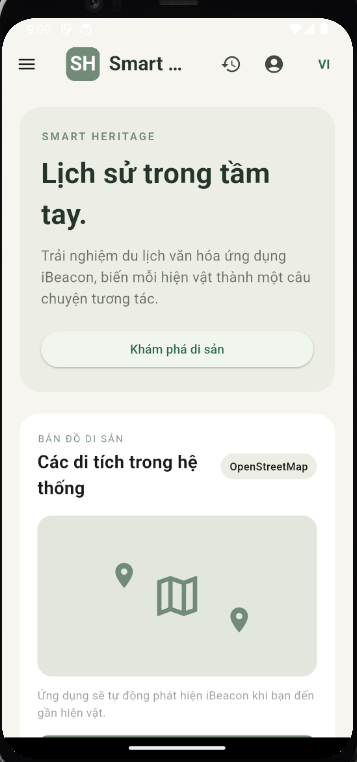

## 2. Cài đặt và đăng nhập lần đầu

### 2.1. Yêu cầu thiết bị

| Yêu cầu | Ghi chú |
|---|---|
| Android | Có Bluetooth LE |
| Quyền Bluetooth (Android 12+) | Cần cho luồng quét iBeacon thật |
| Quyền vị trí | Cần để hiện vị trí của bạn trên bản đồ và tính khoảng cách tới di tích |
| Kết nối mạng | Dùng Wi-Fi/4G trỏ tới máy chủ Smart Heritage |

### 2.2. Cài app (bản thử nghiệm)

1. Cài file APK do nhóm phát triển gửi (`app-debug.apk`).
2. Nếu Android chặn cài đặt, bật *Cài đặt → Ứng dụng → Smart Heritage → Cho phép từ nguồn này*.
3. Mở app, đồng ý 2 quyền được hỏi (vị trí, thông báo).

`TODO`: ảnh màn hình cấp quyền (`images/02-permissions.png`).

### 2.3. Trỏ app về máy chủ (dành cho nhóm phát triển)

App lấy địa chỉ máy chủ theo thứ tự: biến `API_BASE_URL` → `http://10.0.2.2:8080` (emulator Android) → `http://localhost:8080`.

```bash
cd Interface
flutter build apk --debug --dart-define=API_BASE_URL=http://10.0.2.2:8080
adb install -r build/app/outputs/flutter-apk/app-debug.apk
```

Trên điện thoại thật, thay bằng IP LAN của máy chạy Gateway, ví dụ `--dart-define=API_BASE_URL=http://192.168.1.10:8080`, điện thoại và máy tính phải cùng Wi-Fi.

### 2.4. Tài khoản dùng thử

| Tài khoản | Mật khẩu | Vai trò |
|---|---|---|
| `visitor_an` | `Test@1234` | Du khách |
| `visitor_mai` | `Test@1234` | Du khách |
| `visitor_john` | `Test@1234` | Du khách, ngôn ngữ mặc định tiếng Anh |

Tài khoản quản trị (`admin`) **không** dùng trên app du khách.

## 3. Trang chủ

Mở app là vào Trang chủ.

Thanh trên cùng, từ trái sang phải: nút ☰ (mở menu), logo **SH** + chữ *Smart Heritage*, biểu tượng 🕘 (**Hiện vật đã xem – đọc offline**), biểu tượng tài khoản (chưa đăng nhập thì mở màn Đăng nhập, đã đăng nhập thì mở Hồ sơ), và nút **VI / EN** đổi ngôn ngữ nhanh.

Các khối trên màn hình, từ trên xuống:

| Khối | Nội dung | Việc du khách làm được |
|---|---|---|
| Khám phá di sản | Nút mở bản đồ di tích | Xem mục 5 |
| Mô phỏng beacon | Nút giả lập phát hiện beacon – **chỉ có ở bản chạy chế độ demo** (xem mục 6.2) | Xem mục 6.2 |
| Bản đồ di sản | Khung *Các di tích trong hệ thống* (nhãn *OpenStreetMap*) + nút *Mở bản đồ di tích* | Bấm để mở bản đồ (mục 5) |
| Hiện vật nổi bật | Danh sách hiện vật kèm ảnh, nhãn beacon, mô tả ngắn | Bấm **Mở câu chuyện** để mở chi tiết (mục 7) |
| Hiện vật đã xem – đọc offline | Những hiện vật đã mở trước đó | Đọc lại khi không có mạng (cùng chức năng với biểu tượng 🕘 trên thanh trên cùng) |
| Hành trình của bạn | Nút **Xem lịch sử tham quan** – mở lịch sử thật lấy từ máy chủ | Xem mục 9 |

Trang chủ **không** còn hiển thị các ô số liệu gõ cứng (số khách / lượt tương tác / điểm trung bình) như bản trước; số liệu thật chỉ có trên Web Admin.

Menu ☰ (góc trên trái) chứa: **Trang chủ**, **Bản đồ di tích**, và khi chưa đăng nhập là **Đăng nhập / Đăng ký**; khi đã đăng nhập là **Hồ sơ cá nhân**, **Hiện vật yêu thích**, **Lịch sử tham quan**, **Đánh giá của tôi**, **Đăng xuất**.

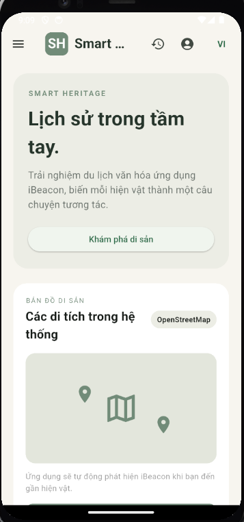

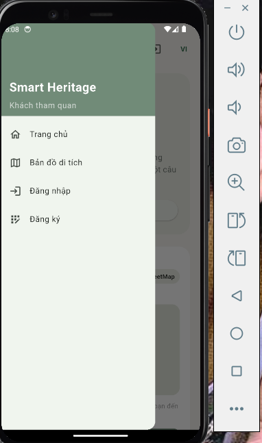

## 4. Đăng ký, đăng nhập, hồ sơ

- **Đăng ký**: menu ☰ → *Đăng ký* → nhập tên đăng nhập, email, mật khẩu, họ tên → *Đăng ký*.
- **Đăng nhập**: menu ☰ → *Đăng nhập* → nhập tài khoản/mật khẩu → *Đăng nhập*.
- Đăng nhập xong, app nhớ phiên: tắt app mở lại vẫn còn đăng nhập cho tới khi token hết hạn hoặc bấm *Đăng xuất*.
- **Hồ sơ cá nhân**: xem họ tên, email, ngôn ngữ ưa thích; đổi ngôn ngữ tại đây sẽ đổi ngôn ngữ nội dung hiện vật.
- **Đăng xuất**: menu ☰ → *Đăng xuất*; các màn Yêu thích / Lịch sử / Đánh giá của tôi yêu cầu đăng nhập lại.

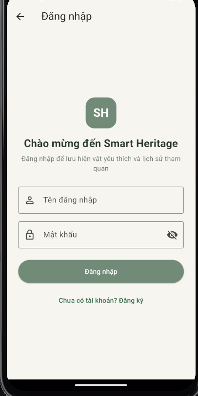

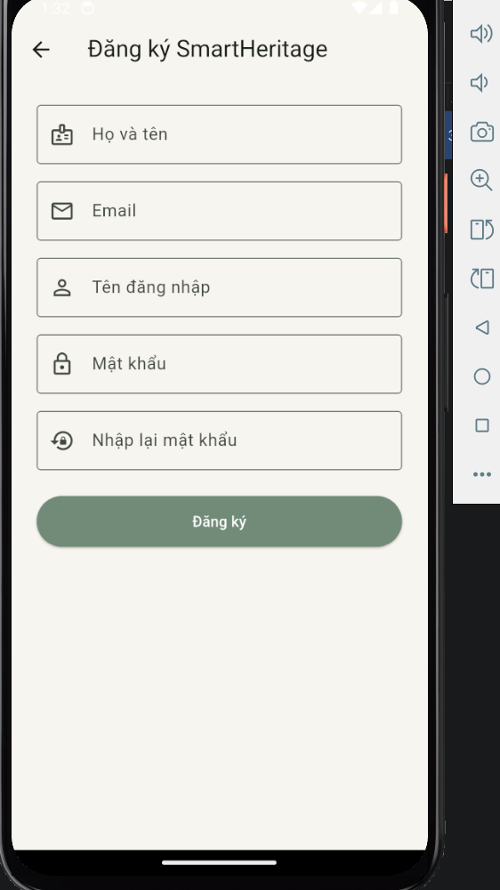

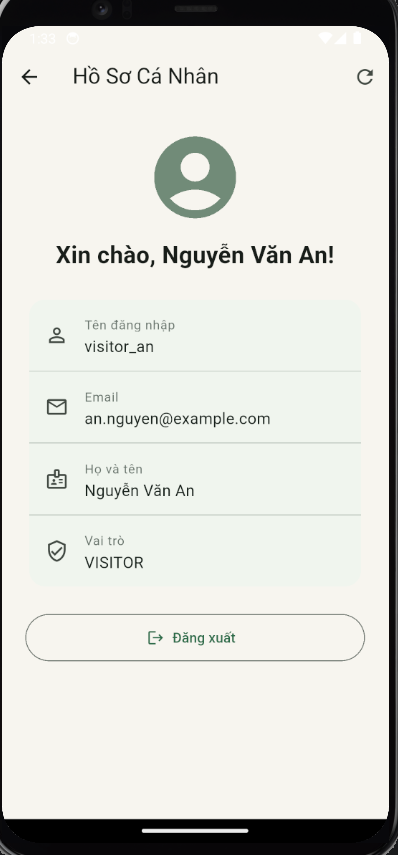

## 5. Bản đồ di tích

1. Menu ☰ → *Bản đồ di tích* (hoặc nút *Mở bản đồ di tích* ở Trang chủ).
2. Bản đồ hiện marker của các di tích, sắp xếp theo khoảng cách từ vị trí của bạn (gần → xa).
3. Bấm một marker để xem tên, địa chỉ, khoảng cách và danh sách hiện vật thuộc di tích đó.
4. Bấm **Chỉ đường** để mở ứng dụng bản đồ của điện thoại với toạ độ di tích.

Trường hợp đặc biệt:

| Tình huống | App làm gì |
|---|---|
| Từ chối quyền vị trí | Vẫn hiện bản đồ và danh sách di tích, kèm hướng dẫn bật quyền trong Cài đặt |
| Mất mạng | Báo lỗi kết nối, không treo app; danh sách đã tải trước đó vẫn xem được |
| Ảnh sơ đồ di tích không tải được | Khung bản đồ để trắng nhưng marker vẫn đúng vị trí (lỗi dữ liệu mẫu, đã ghi nhận) |

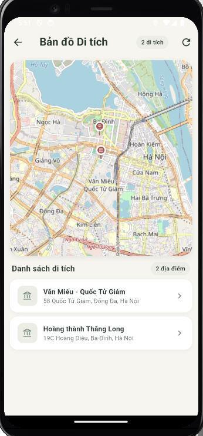

## 6. Nghe thuyết minh tại hiện vật

### 6.1. Dùng beacon thật

1. Bật Bluetooth và quyền vị trí cho app.
2. Menu ☰ → *Trang chủ* → **Quét iBeacon thật**.
3. Đi tới gần hiện vật (cách beacon khoảng 1–2 m). App hiện UUID / Major / Minor / RSSI, cập nhật khoảng 1 giây một lần.
4. Khi tín hiệu đủ mạnh, app tự mở chi tiết hiện vật.
5. Đi ra khỏi vùng: màn chi tiết **không** tự đóng, audio vẫn phát tiếp; app ghi lại một lượt tham quan.

App chỉ báo một lần cho mỗi lần vào vùng; đứng yên không báo lặp, sang beacon khác thì báo hiện vật mới.

### 6.2. Không có beacon – dùng chế độ giả lập

Nút **Mô phỏng beacon** (và nút *Phát hiện hiện vật gần bạn (demo) →* ở khối BLE) **chỉ xuất hiện khi app chạy ở chế độ demo**:

```bash
flutter run --dart-define=DEMO_MODE=true
# hoặc khi build APK demo
flutter build apk --debug --dart-define=DEMO_MODE=true
```

Bản cài thường **không** có hai nút này. Khi đó, để xem nội dung mà không có beacon thật:

1. Trang chủ → khối **Hiện vật nổi bật** → **Mở câu chuyện** (app vẫn ghi một lượt tham quan với nguồn *thủ công*).
2. Hoặc **Quét iBeacon thật** nếu có thiết bị phát beacon bên cạnh.

Ở bản demo:

1. Trang chủ → **Mô phỏng beacon**.
2. Hộp thoại *Beacon được phát hiện* hiện hiện vật mẫu (Khuê Văn Các, khoảng 2 m).
3. Bấm **Xem hiện vật** để mở chi tiết; app chạy đúng luồng như beacon thật (chống báo trùng, ghi lượt tham quan khi ra vùng).

Chế độ này dùng cho buổi demo và cho máy ảo (emulator không quét được BLE).


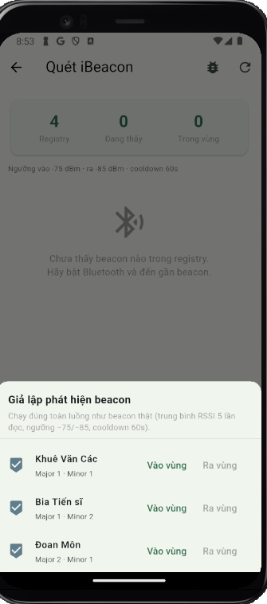

## 7. Chi tiết hiện vật

| Thành phần | Cách dùng |
|---|---|
| Tên, mô tả | Cuộn để đọc; nội dung theo ngôn ngữ đang chọn |
| Nút **VI / EN** (góc trên) | Đổi ngôn ngữ; nội dung đổi trong khoảng 2 giây. Hiện vật chưa có bản dịch sẽ hiện nhãn *"Chưa có bản dịch, đang hiển thị tiếng Việt"* và vẫn đọc được bản tiếng Việt |
| Ảnh | Bấm để phóng to; ảnh lỗi hiện ảnh thay thế, không làm treo app |
| Audio | Phát / tạm dừng / tua; hiện thời lượng. Rời màn hình thì audio dừng |
| Video | Phát, xoay toàn màn hình; rời màn hình thì dừng |
| Nút **Yêu thích** | Thêm/bỏ yêu thích ngay tại chỗ (cần đăng nhập) |
| Nút **Đánh giá** | Mở màn đánh giá của hiện vật (mục 10) |

Đọc lại khi mất mạng: app lưu tối đa **20 hiện vật xem gần nhất**. Hiện vật đã xem mở được offline; hiện vật chưa xem báo mất mạng, không treo app.

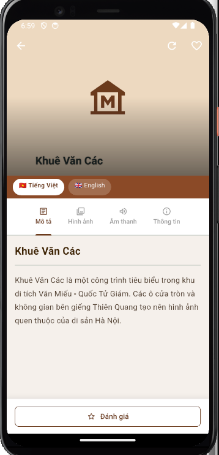

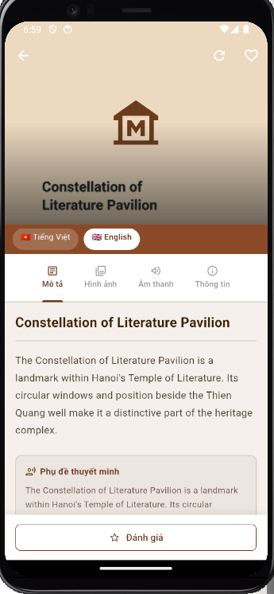

## 8. Yêu thích

- Bấm nút yêu thích ở màn chi tiết, hoặc vào menu ☰ → *Hiện vật yêu thích*.
- Danh sách hiện vật đã lưu, bấm để mở lại chi tiết; bỏ yêu thích ngay trong danh sách.
- Thêm trùng không tạo 2 dòng; bỏ rồi thêm lại vẫn đúng 1 dòng.
- Chưa đăng nhập: màn này yêu cầu đăng nhập trước.

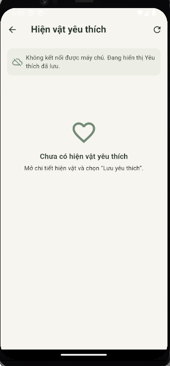

## 9. Lịch sử tham quan

- Menu ☰ → *Lịch sử tham quan*. Danh sách lượt tham quan, mới nhất trước, kèm hiện vật và thời gian.
- Một lượt được ghi khi bạn rời vùng beacon, hoặc khi dùng chế độ giả lập rồi bấm ra vùng.
- **Không có mạng**: lượt tham quan được xếp vào hàng đợi trong máy, tự gửi lại khi có mạng; gửi lại nhiều lần không sinh lượt trùng.
- Chỉ thấy lịch sử của chính mình.

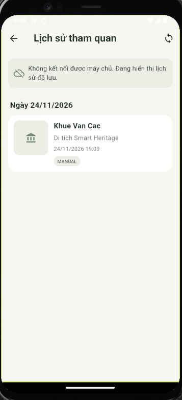

## 10. Đánh giá hiện vật

### 10.1. Gửi đánh giá

1. Mở chi tiết hiện vật → **Đánh giá**.
2. Chọn số sao (1–5), nhập bình luận (tối đa 500 ký tự).
3. Bấm **Gửi**. App báo *"Đã gửi đánh giá"* và hiện trạng thái **Chờ duyệt**.

Đánh giá **chưa** hiện công khai cho tới khi quản trị viên duyệt.

### 10.2. Sửa đánh giá đã gửi

Gửi lại cho cùng hiện vật = **sửa** đánh giá cũ (không tạo đánh giá thứ hai). App báo *"Đã cập nhật đánh giá"*; đánh giá quay về trạng thái Chờ duyệt cho tới khi được duyệt lại.

### 10.3. Xem đánh giá của hiện vật

- Màn đánh giá hiện điểm trung bình, số lượt theo mức sao và các bình luận **đã duyệt**.
- Chưa đăng nhập: vẫn xem được điểm và bình luận, nhưng chỗ form đánh giá là nút **Đăng nhập để đánh giá**.

### 10.4. Đánh giá của tôi

Menu ☰ → *Đánh giá của tôi*: danh sách đánh giá bạn đã gửi kèm trạng thái (Chờ duyệt / Đã duyệt / Từ chối).

### 10.5. Thông báo khi đánh giá được duyệt

Khi quản trị viên duyệt đánh giá, app nhận thông báo *"Đánh giá của bạn về &lt;tên hiện vật&gt; đã được duyệt"*. Bấm thông báo để mở lại hiện vật.

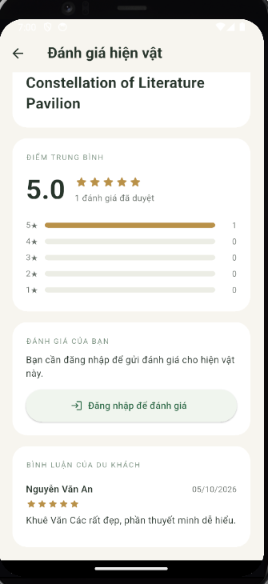

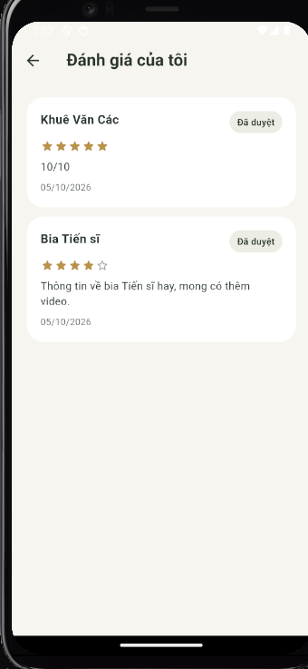

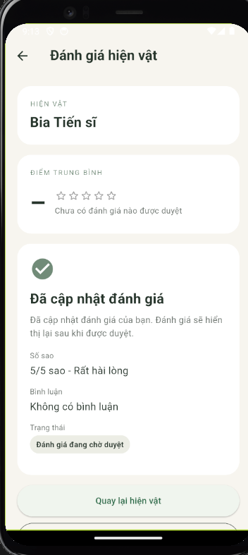

## 11. Xử lý sự cố

| Hiện tượng | Nguyên nhân thường gặp | Cách xử lý |
|---|---|---|
| App báo không kết nối được máy chủ | Sai địa chỉ máy chủ, khác Wi-Fi, Gateway chưa chạy | Kiểm tra lại `API_BASE_URL`, dùng chung Wi-Fi, nhờ nhóm kiểm tra Gateway 8080 |
| Vào vùng beacon mà không thấy hiện vật | Chưa bật Bluetooth/quyền vị trí, beacon chưa nằm trong registry, tín hiệu yếu | Bật Bluetooth và quyền, lại gần beacon, hoặc dùng chế độ giả lập |
| Bản đồ trắng nhưng vẫn có marker | Ảnh sơ đồ di tích đang là dữ liệu mẫu | Bỏ qua – marker và thông tin vẫn đúng |
| Audio/video không phát | Mất mạng giữa lúc tải, định dạng không hỗ trợ | Tải lại khi có mạng; báo nhóm nếu file sai định dạng |
| Không đổi được sang tiếng Anh | Hiện vật chưa có bản dịch | App hiện bản tiếng Việt kèm nhãn "Chưa có bản dịch…" – đúng thiết kế |
| Đánh giá gửi xong không thấy công khai | Đang chờ quản trị viên duyệt | Theo dõi ở *Đánh giá của tôi* |
| Lịch sử thiếu lượt vừa đi | Chưa rời vùng beacon hoặc đang chờ đồng bộ | Ra khỏi vùng, chờ có mạng rồi kéo để tải lại |

## 12. Phụ lục

### 12.1. Bảng thuật ngữ

| Thuật ngữ | Nghĩa trong app |
|---|---|
| Beacon / iBeacon | Thiết bị phát tín hiệu Bluetooth đặt tại hiện vật; app dựa vào đó để biết bạn đang đứng ở đâu |
| Registry | Danh sách beacon do quản trị viên đăng ký, kèm hiện vật được gán |
| Fallback | Hiện vật chưa có bản dịch ngôn ngữ đang chọn nên app hiện bản tiếng Việt |
| Hàng đợi ngoại tuyến | Các lượt tham quan được giữ lại trong máy khi mất mạng, gửi lại khi có mạng |

### 12.2. Ảnh cần bổ sung (làm sau khi chạy hồi quy)

- [x] `01-home.png` – Trang chủ
- [ ] `02-permissions.png` – Hộp thoại xin quyền (chưa có ảnh)
- [x] `03-home.png` – Trang chủ
- [x] `04-sidebar.png` – menu ☰
- [x] `05-login.png` – Đăng nhập
- [x] `06-register.png` – Đăng ký
- [x] `07-profile.png` – Hồ sơ
- [x] `08-map.png` – Bản đồ có marker và bảng thông tin
- [x] `09-scan.png`, `10-simulate.png` – Quét beacon thật / chọn beacon giả lập
- [x] `11-detail.png`, `12-detail-en.png` – Chi tiết VI và EN
- [x] `13-favorites.png`, `14-history.png`
- [x] `15-review.png`, `16-my-reviews.png`, `17-notification.png`

### 12.3. Đối chiếu test case

| Mục tài liệu | Test case tương ứng (`test-plan.md`) |
|---|---|
| 4. Đăng nhập / hồ sơ | TC-02, TC-05, TC-06 |
| 5. Bản đồ | TC-09, TC-51, TC-52, TC-53 |
| 6. Beacon | TC-10, TC-11, TC-50, TC-58, TC-59, TC-60, TC-61 |
| 7. Chi tiết hiện vật | TC-12, TC-13, TC-14, TC-54, TC-55, TC-56, TC-57, TC-119 |
| 8. Yêu thích | TC-15, TC-64, TC-112 |
| 9. Lịch sử | TC-16, TC-62, TC-63, TC-111 |
| 10. Đánh giá | TC-17, TC-18, TC-19, TC-20, TC-21, TC-65, TC-66, TC-67, TC-68, TC-101, TC-114, TC-115, TC-116 |
| 11. Xử lý sự cố | TC-53, TC-57, TC-113, TC-125, TC-126, TC-127 |

### 12.4. Ghi chú khi chốt tài liệu

- Ảnh chụp phải lấy từ **bản APK của tag phát hành**, không dùng ảnh cũ.
- Mỗi lần đổi nhãn nút hoặc luồng màn hình, cập nhật lại mục tương ứng **và** mục 12.3 trước khi merge.
- Tài liệu này chưa kiểm chứng phần quét beacon thật (cần máy Android thật + thiết bị phát beacon); các mục 6.1 và 11 sẽ chốt sau buổi chạy hồi quy cuối.
- Ảnh Trang chủ phải chụp **bản APK phát hành (không bật `DEMO_MODE`)**; nếu cần ảnh minh hoạ nút *Mô phỏng beacon* cho mục 6.2 thì chụp riêng từ bản demo.
