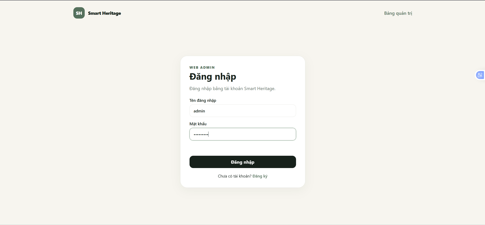
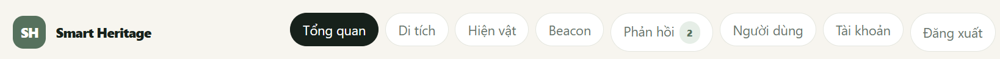
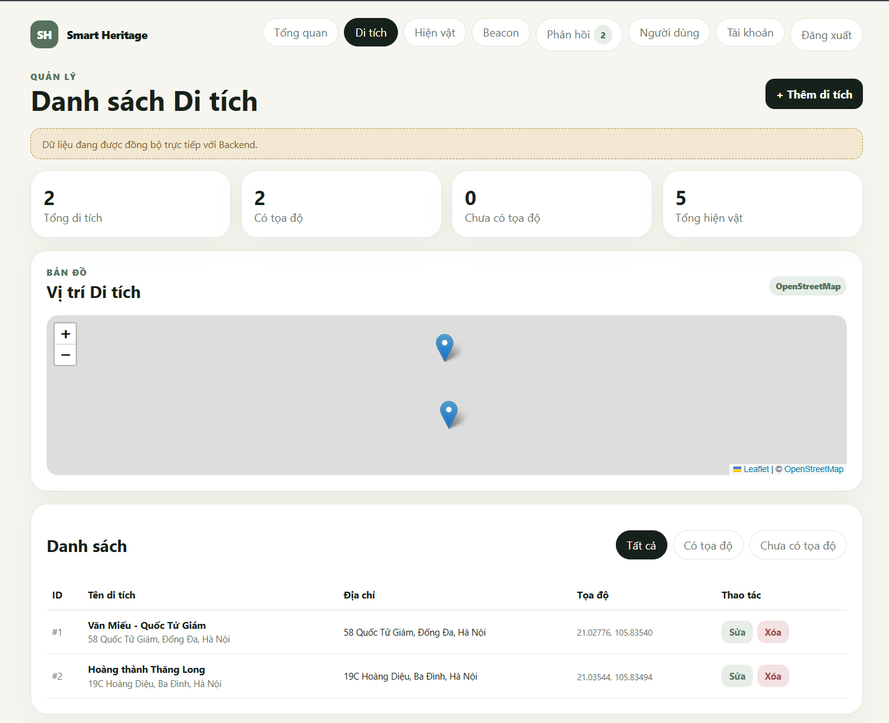
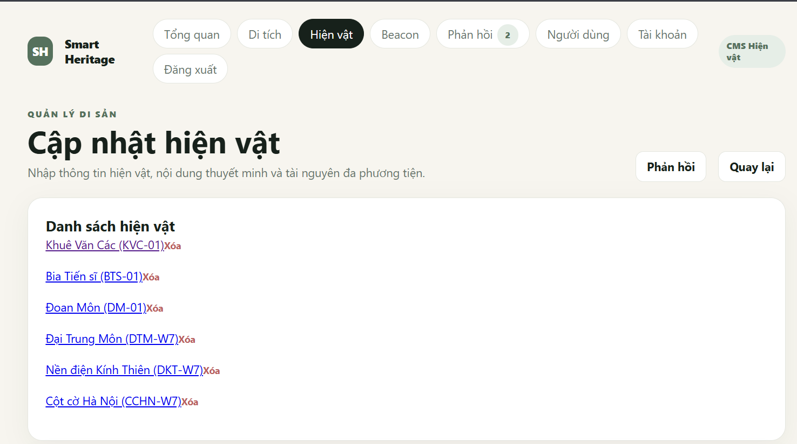
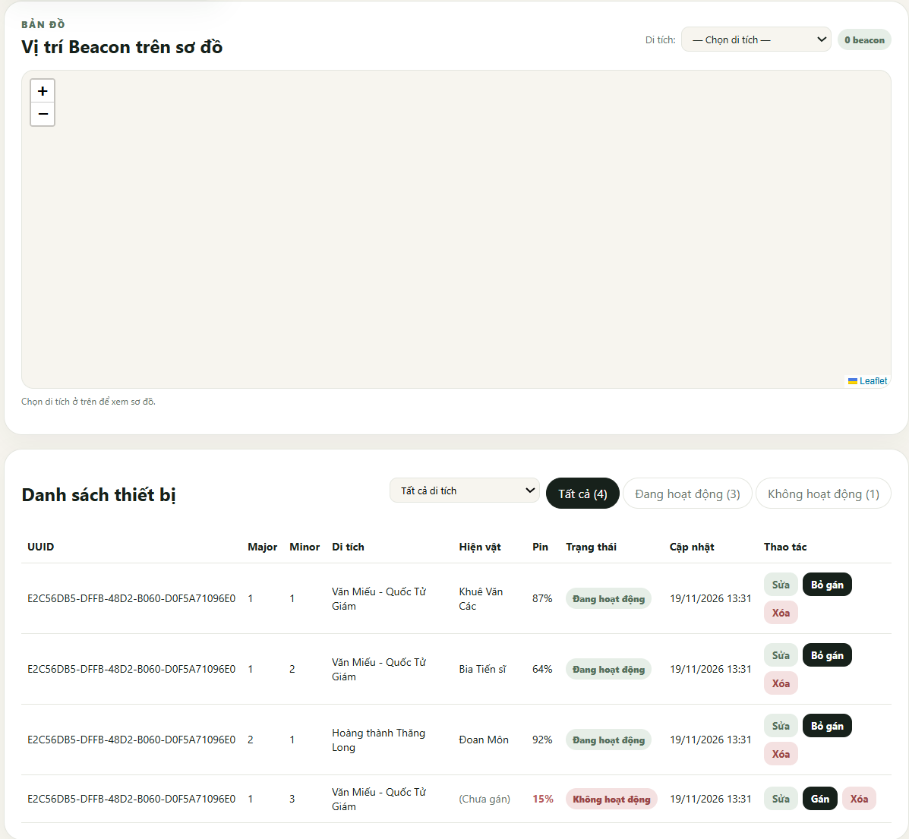
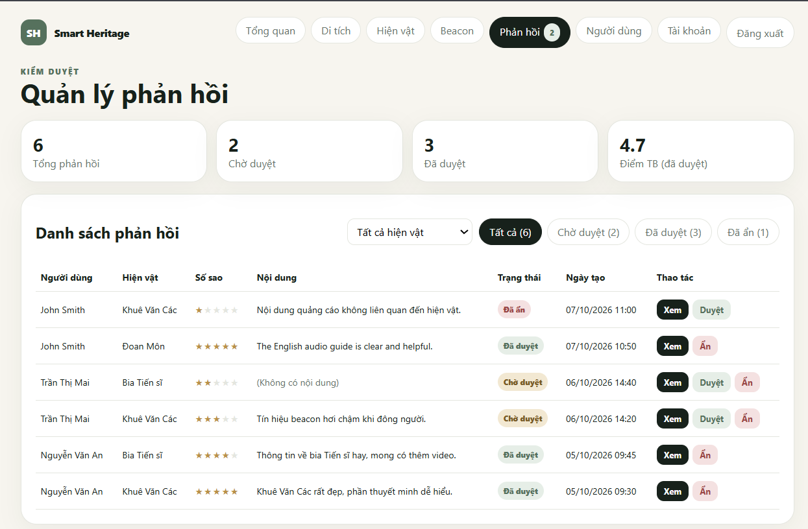
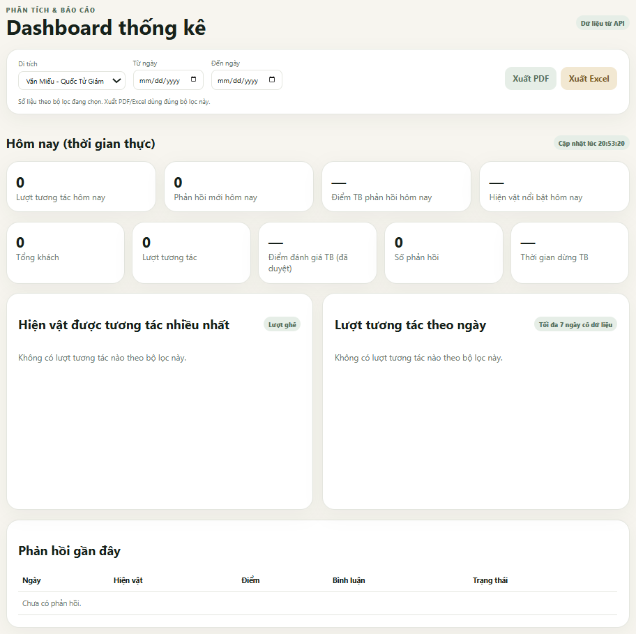
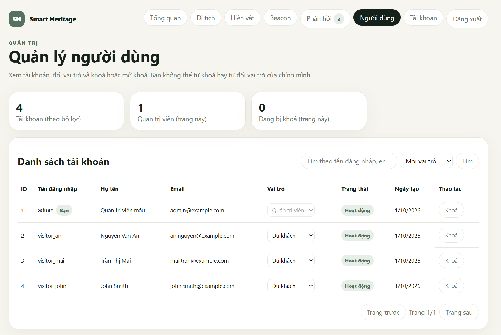
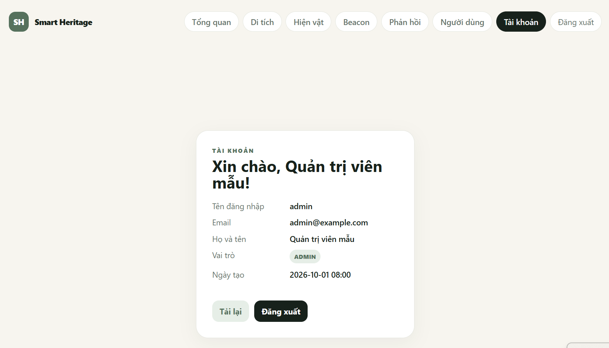

# Hướng dẫn sử dụng Web Admin – Smart Heritage (dành cho Quản trị viên)

| Mục | Nội dung |
|---|---|
| Người viết | Tường |
| Đối tượng | Ban quản lý di tích (tài khoản vai trò ADMIN) |
| Phiên bản hệ thống | v1.0 (tuần 7) |
| Trạng thái | Bản khung: đã có các bước, **chưa có ảnh chụp** (chụp ngày 19/11 trên bản đã chốt giao diện và có dữ liệu demo) |

Phần du khách (app Android) xem tài liệu của Ân.

## Mục lục

1. [Chuẩn bị và mở Web Admin](#1-chuẩn-bị-và-mở-web-admin)
2. [Đăng nhập](#2-đăng-nhập)
3. [Menu chung](#3-menu-chung)
4. [Quản lý di tích](#4-quản-lý-di-tích)
5. [Quản lý hiện vật](#5-quản-lý-hiện-vật)
6. [Bản dịch, thuyết minh và ngôn ngữ](#6-bản-dịch-thuyết-minh-và-ngôn-ngữ)
7. [Quản lý iBeacon](#7-quản-lý-ibeacon)
8. [Sơ đồ vị trí beacon](#8-sơ-đồ-vị-trí-beacon)
9. [Duyệt đánh giá (Phản hồi)](#9-duyệt-đánh-giá-phản-hồi)
10. [Dashboard thống kê](#10-dashboard-thống-kê)
11. [Xuất báo cáo PDF/Excel](#11-xuất-báo-cáo-pdfexcel)
12. [Quản lý người dùng](#12-quản-lý-người-dùng)
13. [Hồ sơ và đăng xuất](#13-hồ-sơ-và-đăng-xuất)
14. [Lỗi thường gặp](#14-lỗi-thường-gặp)

---

## 1. Chuẩn bị và mở Web Admin

**Mục đích:** mở được trang quản trị trên máy tính.

**Cần có:**
- Hệ thống đang chạy (làm theo `Docs/deployment/deployment-guide.md`). Web Admin gọi API qua Gateway `http://localhost:8080`.
- Trình duyệt Chrome hoặc Edge bản mới; có Internet để tải bản đồ và biểu đồ.
- Tài khoản ADMIN. Tài khoản mẫu: `admin` / `Test@1234`.

**Các bước:**
1. Mở thư mục `WebAdmin` trong VS Code.
2. Bấm chuột phải vào `src/pages/login.html` → **Open with Live Server**.
3. Trình duyệt mở trang **Đăng nhập**.

**Kết quả:** thấy ô **Tên đăng nhập**, **Mật khẩu** và nút **Đăng nhập**.

## 2. Đăng nhập

**Mục đích:** vào trang quản trị bằng tài khoản ADMIN.

**Các bước:**
1. Nhập **Tên đăng nhập** và **Mật khẩu**.
2. Bấm **Đăng nhập**.

**Kết quả:**
- Tài khoản ADMIN: chuyển tới **Dashboard thống kê** (hoặc trang bạn đang mở dở trước khi bị yêu cầu đăng nhập).
- Tài khoản du khách: chỉ vào được **Hồ sơ cá nhân**, không có menu quản trị.
- Tài khoản bị khoá: báo "Tài khoản đã bị khoá, vui lòng liên hệ quản trị viên!".

**Lưu ý:** phiên đăng nhập tự gia hạn. Khi hết phiên, trang tự chuyển về **Đăng nhập**; đăng nhập lại sẽ quay về đúng trang cũ.

## 3. Menu chung

**Mục đích:** đi tới mọi trang quản trị từ bất kỳ trang nào.

Menu nằm ở đầu mỗi trang (chỉ hiện với ADMIN). Nút của trang đang mở được tô đậm.

| Nút | Trang | Dùng để |
|---|---|---|
| **Tổng quan** | `dashboard.html` | Xem thống kê, xuất báo cáo |
| **Di tích** | `heritage-sites.html` | Thêm, sửa, xóa di tích và vị trí trên bản đồ |
| **Hiện vật** | `artifacts.html` | Thêm, sửa, xóa hiện vật, bản dịch, media |
| **Beacon** | `ibeacons.html` | Quản lý iBeacon, gán hiện vật, sơ đồ vị trí, kiểm tra pin |
| **Phản hồi** | `feedback.html` | Duyệt hoặc ẩn đánh giá của du khách |
| **Người dùng** | `users.html` | Tìm tài khoản, đổi vai trò, khoá/mở khoá |
| **Tài khoản** | `profile.html` | Xem hồ sơ của chính mình |
| **Đăng xuất** | — | Thoát khỏi Web Admin |

Nút **Phản hồi** có số màu đỏ là số đánh giá đang chờ duyệt; không còn đánh giá chờ duyệt thì không hiện số.

## 4. Quản lý di tích

**Mục đích:** khai báo các khu di tích và vị trí của chúng trên bản đồ (du khách thấy trên màn Bản đồ của app).

Trang **Danh sách Di tích** gồm bản đồ **Vị trí Di tích** và bảng **Danh sách** (cột ID, Tên di tích, Địa chỉ, Tọa độ, Thao tác). Lọc nhanh bằng **Tất cả**, **Có tọa độ**, **Chưa có tọa độ**.

**Thêm di tích:**
1. Bấm **+ Thêm di tích**.
2. Nhập **Tên di tích** (bắt buộc), **Địa chỉ**, **URL ảnh bản đồ** (ảnh sơ đồ khu di tích, dùng cho trang Beacon).
3. Chọn vị trí: bấm vào bản đồ ở mục **Chọn tọa độ trên bản đồ**, hoặc nhập tay **Vĩ độ (Latitude)** và **Kinh độ (Longitude)**.
4. Bấm **Lưu**.

**Sửa / xóa:** ở cột **Thao tác**, bấm **Sửa** (đổi thông tin rồi bấm **Lưu thay đổi**) hoặc **Xóa** (xác nhận trong hộp thoại).

**Kết quả:** di tích hiện trong bảng và có ghim trên bản đồ (nếu có tọa độ).

**Lưu ý:**
- Phải nhập cả vĩ độ và kinh độ, hoặc để trống cả hai. Vĩ độ từ -90 đến 90, kinh độ từ -180 đến 180.
- Xóa tọa độ của di tích đang có vị trí sẽ hỏi xác nhận.

## 5. Quản lý hiện vật

**Mục đích:** tạo hồ sơ hiện vật để du khách xem khi đến gần beacon.

Trang **Thêm hiện vật** có bên trái là **Danh sách hiện vật**, bên phải là biểu mẫu.

**Thêm hiện vật:**
1. Ở mục **Thông tin hiện vật**: chọn **Địa điểm di tích** (bắt buộc), nhập **Tên hiện vật** (bắt buộc).
2. Nhập thêm nếu có: **Mã hiện vật**, **Mô tả**, **URL ảnh đại diện**, **Niên đại / thời kỳ**, **Chất liệu**, **Kích thước**, **Beacon UUID**.
3. **Trạng thái**: **Đang hoạt động** (du khách xem được) hoặc **Ngừng hoạt động**.
4. Thêm bản dịch và media (mục 6).
5. Bấm **Lưu hiện vật**. Dòng trạng thái báo "Đã lưu hiện vật #id".

**Sửa:** bấm tên hiện vật trong **Danh sách hiện vật**, biểu mẫu nạp dữ liệu cũ; sửa rồi bấm **Lưu hiện vật**.

**Xóa:** bấm **Xóa** cạnh tên hiện vật, xác nhận. Nút **Xóa nội dung** chỉ làm trống biểu mẫu để nhập hiện vật mới, không xóa dữ liệu đã lưu.

**Tài nguyên đa phương tiện:** bấm **+ Thêm tài nguyên**, chọn **Loại tài nguyên** (Hình ảnh, Âm thanh, Video), nhập **URL tệp** hoặc tải tệp từ máy, thêm **Chú thích**. Bỏ một tài nguyên bằng **Xóa tài nguyên**.

**Lưu ý:**
- URL phải bắt đầu bằng `http://` hoặc `https://`.
- Tệp tải lên tối đa: ảnh 10 MB, audio 30 MB, video 100 MB. Tải xong vẫn phải bấm **Lưu hiện vật**.

## 6. Bản dịch, thuyết minh và ngôn ngữ

**Mục đích:** mỗi hiện vật có nội dung theo ngôn ngữ của du khách (app tự chọn theo ngôn ngữ tài khoản; thiếu bản dịch thì dùng bản tiếng Việt).

**Thêm bản dịch cho hiện vật** (mục **Bản dịch và thuyết minh**, trên trang Hiện vật):
1. Bấm **+ Thêm ngôn ngữ**.
2. Chọn **Ngôn ngữ** (bắt buộc), nhập **Tiêu đề** và **Nội dung thuyết minh** (bắt buộc).
3. Nhập nếu có: **URL audio**, **URL video**, **URL hình ảnh** (mỗi URL một dòng).
4. Bấm **Lưu hiện vật**.

Mỗi ngôn ngữ chỉ có 1 bản dịch cho 1 hiện vật. Bỏ bản dịch bằng **Xóa bản dịch**.

**Thêm ngôn ngữ mới cho hệ thống** (mục **Ngôn ngữ hỗ trợ**):
1. Nhập **Mã ngôn ngữ** (ví dụ `fr`) và **Tên ngôn ngữ** (ví dụ `Français`).
2. Tick **Đang hoạt động**, bấm **Thêm ngôn ngữ**.
3. Ngôn ngữ đã có: sửa tên hoặc bật/tắt rồi bấm **Lưu** trên dòng đó.

## 7. Quản lý iBeacon

**Mục đích:** khai báo thiết bị iBeacon đặt cạnh hiện vật, để app nhận diện hiện vật khi du khách đến gần.

Trang **Quản lý iBeacon** có bảng **Danh sách thiết bị** (UUID, Major, Minor, Di tích, Hiện vật, Pin, Trạng thái, Cập nhật, Thao tác). Lọc theo di tích và **Tất cả / Đang hoạt động / Không hoạt động**.

**Thêm iBeacon:**
1. Bấm **+ Thêm iBeacon**.
2. Chọn **Di tích**, nhập **Major**, **Minor** (số 0–65535) và **UUID (iBeacon)** dạng `8-4-4-4-12` ký tự hex.
3. Nhập nếu có: **Toạ độ X**, **Toạ độ Y** trên sơ đồ, **Pin 0–100%**, **Trạng thái**.
4. Bấm **Lưu**.

**Gán hiện vật cho beacon:**
1. Ở cột **Thao tác**, bấm **Gán** (beacon đã gán hiện vật thì nút là **Bỏ gán**, mở cùng hộp thoại).
2. Trong hộp **Gán hiện vật**, chọn ở ô **Hiện vật cùng di tích** (chỉ gán được hiện vật cùng di tích với beacon).
3. Bấm **Lưu gán**. Muốn tháo hiện vật, chọn **— Bỏ gán (chưa gán hiện vật) —** rồi bấm **Lưu gán**.

**Kiểm tra pin:** hệ thống tự quét mỗi 15 phút; muốn quét ngay thì bấm **🔋 Kiểm tra pin ngay**. Beacon đang hoạt động có pin dưới 20% hiện biểu tượng cảnh báo trong bảng và quản trị viên nhận thông báo. Thay pin xong (pin từ 20% trở lên) thì cảnh báo tự tắt.

**Sửa / xóa:** bấm **Sửa** hoặc **Xóa** ở cột **Thao tác**.

## 8. Sơ đồ vị trí beacon

**Mục đích:** đặt beacon đúng chỗ trên sơ đồ khu di tích để dễ bảo trì.

**Cần có:** di tích đã có **URL ảnh bản đồ** (mục 4).

**Các bước:**
1. Ở mục **Vị trí Beacon trên sơ đồ**, chọn di tích.
2. Beacon chưa có vị trí: trong bảng bấm **📍 Đặt trên bản đồ**, rồi bấm vào điểm cần đặt trên sơ đồ.
3. Đổi vị trí: kéo ghim tới chỗ mới rồi thả chuột, hệ thống tự lưu.
4. Bấm vào ghim để xem hiện vật và trạng thái của beacon.

**Kết quả:** ghim hiện đúng chỗ, tải lại trang vẫn giữ vị trí.

## 9. Duyệt đánh giá (Phản hồi)

**Mục đích:** kiểm duyệt đánh giá của du khách. Chỉ đánh giá **Đã duyệt** mới hiện công khai trong app và được tính vào điểm trung bình.

Trang **Quản lý phản hồi** có bảng **Danh sách phản hồi** (Người dùng, Hiện vật, Số sao, Nội dung, Trạng thái, Ngày tạo, Thao tác). Lọc theo hiện vật và **Tất cả / Chờ duyệt / Đã duyệt / Đã ẩn**.

**Các bước:**
1. Bấm **Chờ duyệt** để xem các đánh giá mới.
2. Bấm **Xem** để đọc toàn bộ nội dung trong hộp **Chi tiết đánh giá**.
3. Bấm **Duyệt** để hiện công khai, hoặc **Ẩn** để không hiện.

**Kết quả:**
- Trạng thái đổi ngay, số trên nút **Phản hồi** giảm.
- Duyệt một đánh giá: du khách nhận thông báo trên điện thoại.
- Du khách sửa đánh giá đã duyệt: đánh giá quay về **Chờ duyệt** và cần duyệt lại.

## 10. Dashboard thống kê

**Mục đích:** theo dõi lượt khách và mức độ quan tâm tới từng hiện vật.

Trang **Dashboard thống kê** gồm:
- Thẻ số liệu: Tổng khách, Lượt tương tác, Điểm đánh giá TB (đã duyệt), Số phản hồi, Thời gian dừng TB.
- **Hôm nay (thời gian thực)**: lượt tương tác, phản hồi mới, điểm TB và hiện vật nổi bật hôm nay; tự cập nhật mỗi 15 giây.
- **Hiện vật được tương tác nhiều nhất**, **Lượt tương tác theo ngày** (biểu đồ), **Phản hồi gần đây**.

**Lọc số liệu:**
1. Chọn **Di tích** (hoặc Tất cả di tích).
2. Chọn **Từ ngày**, **Đến ngày**.
3. Số liệu và biểu đồ đổi theo bộ lọc.

## 11. Xuất báo cáo PDF/Excel

**Mục đích:** lấy báo cáo thống kê để lưu trữ hoặc gửi ban quản lý.

**Các bước:**
1. Trên Dashboard, chọn bộ lọc (mục 10).
2. Bấm **Xuất PDF** hoặc **Xuất Excel**.
3. Trình duyệt tải file về thư mục Downloads.

**Kết quả:** file có cùng số liệu với bộ lọc đang chọn; dòng trạng thái báo "Đã tải file …".

## 12. Quản lý người dùng

**Mục đích:** xem tài khoản, đổi vai trò, khoá tài khoản vi phạm.

Trang **Quản lý người dùng** có bảng **Danh sách tài khoản** (ID, Tên đăng nhập, Họ tên, Email, Vai trò, Trạng thái, Ngày tạo, Thao tác).

**Tìm tài khoản:**
1. Gõ vào ô **Tìm theo tên đăng nhập, email, họ tên**, chọn vai trò (**Mọi vai trò / Du khách / Quản trị viên**).
2. Bấm **Tìm**. Dùng **Trang trước** / **Trang sau** khi có nhiều trang.

**Đổi vai trò:** chọn vai trò mới ở cột **Vai trò**, xác nhận trong hộp thoại.

**Khoá / mở khoá:**
1. Bấm **Khoá** ở dòng tài khoản, xác nhận.
2. Tài khoản chuyển sang **Đã khoá**: bị đăng xuất khỏi mọi thiết bị và không đăng nhập được.
3. Bấm **Mở khoá** để cho dùng lại.

**Lưu ý:** dòng của chính bạn có nhãn **Bạn**; không thể tự đổi vai trò hay tự khoá chính mình.

## 13. Hồ sơ và đăng xuất

**Hồ sơ:** bấm **Tài khoản** trên menu để xem thông tin tài khoản đang đăng nhập; **Tải lại** để lấy thông tin mới nhất.

**Đăng xuất:** bấm **Đăng xuất** trên menu (hoặc trên trang Hồ sơ). Trang quay về **Đăng nhập**.

## 14. Lỗi thường gặp

| Hiện tượng | Nguyên nhân | Cách xử lý |
|---|---|---|
| "Không kết nối được máy chủ" | Gateway hoặc service chưa chạy | Kiểm tra hệ thống theo Deployment Guide, tải lại trang |
| "Tài khoản hiện tại không có quyền quản trị" | Đăng nhập bằng tài khoản du khách | Đăng xuất, đăng nhập bằng tài khoản ADMIN |
| Bị đưa về trang Đăng nhập | Phiên hết hạn | Đăng nhập lại, trang tự quay về chỗ cũ |
| Bản đồ hoặc biểu đồ không hiện | Mất Internet (bản đồ, Chart.js tải từ mạng) | Kiểm tra mạng; vẫn nhập tọa độ tay được |
| "Di tích chưa có ảnh sơ đồ" trên trang Beacon | Di tích chưa có URL ảnh bản đồ | Thêm URL ảnh ở trang Di tích (mục 4) |
| Không lưu được hiện vật | Thiếu trường bắt buộc, URL sai, trùng ngôn ngữ bản dịch | Đọc dòng báo lỗi dưới nút Lưu, sửa đúng trường |
